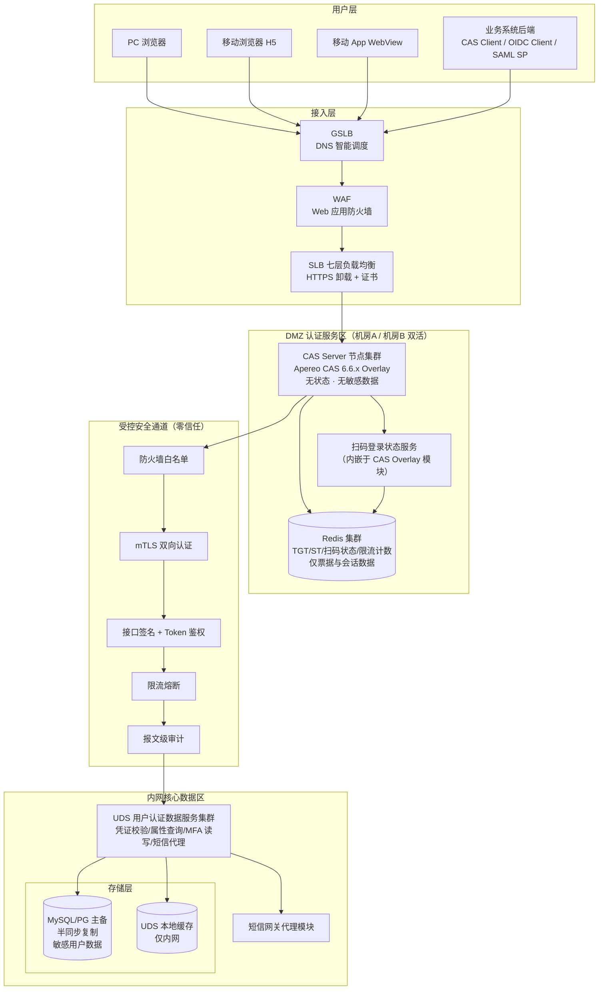
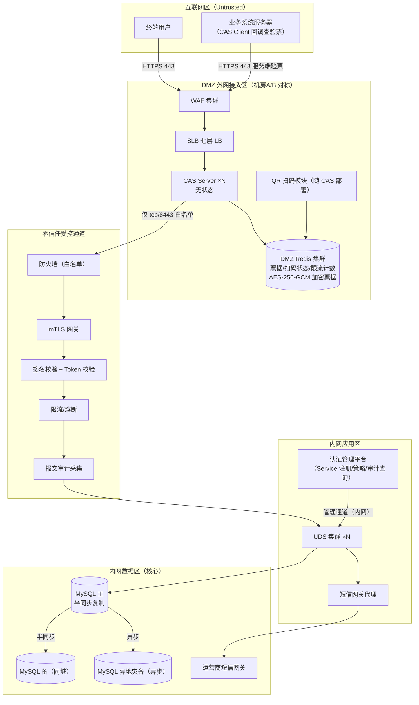
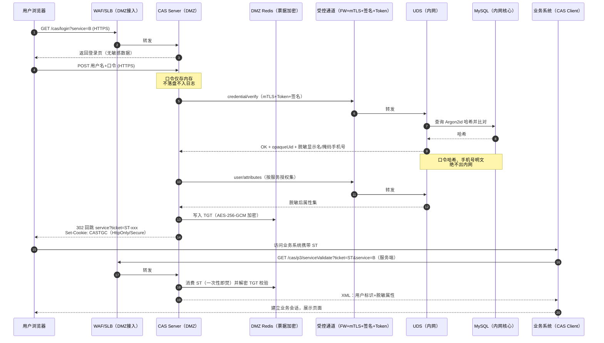
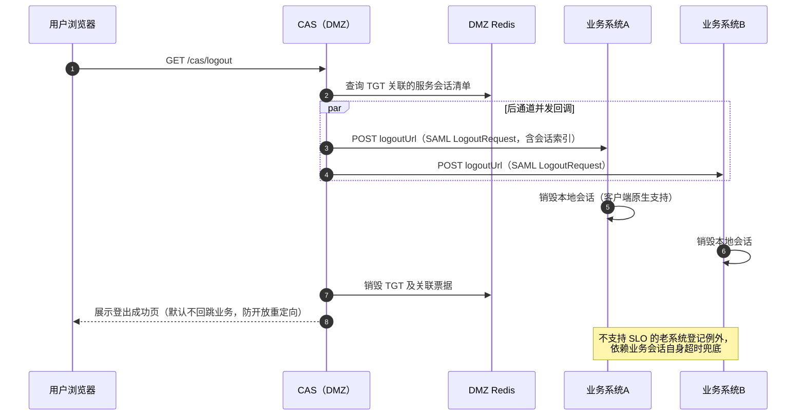
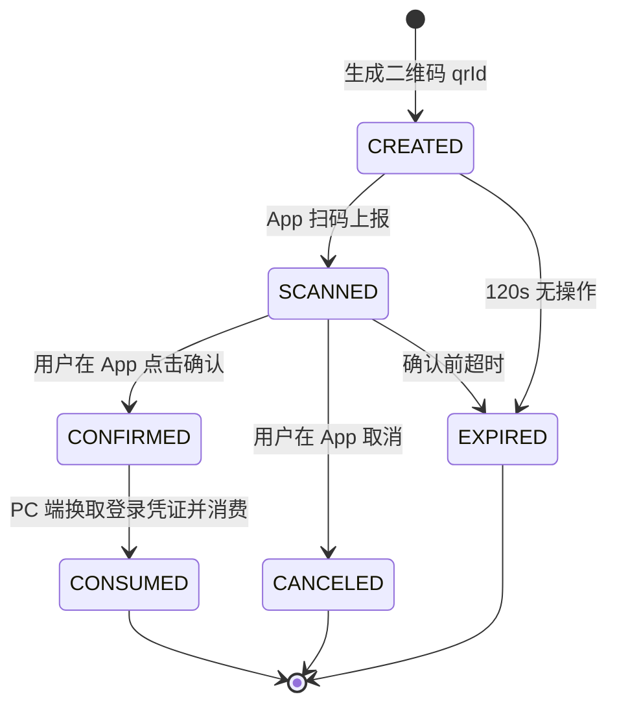
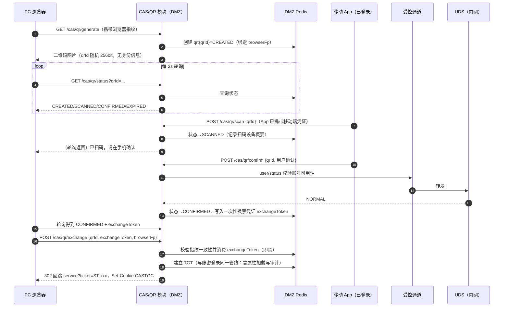
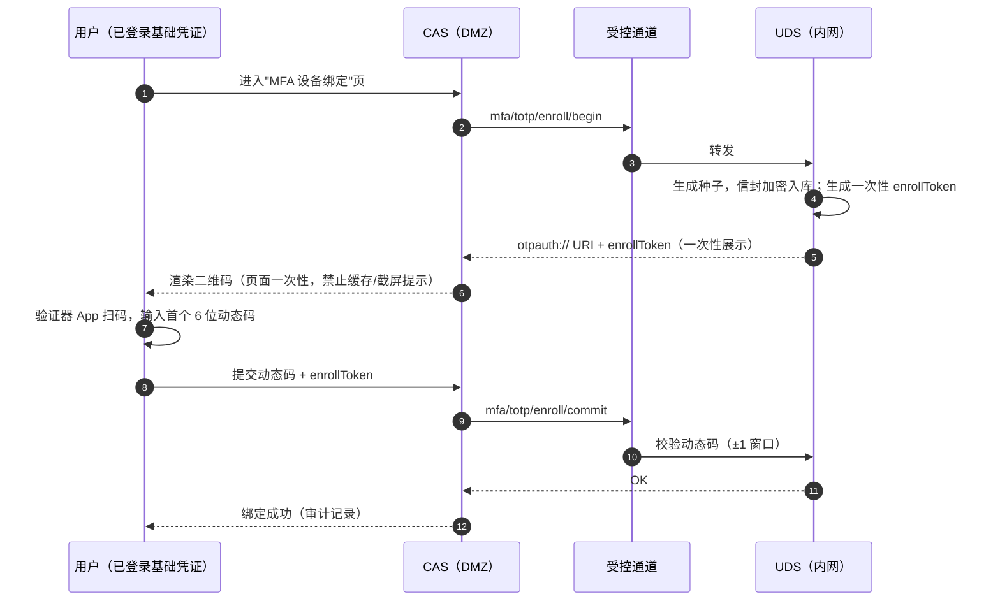
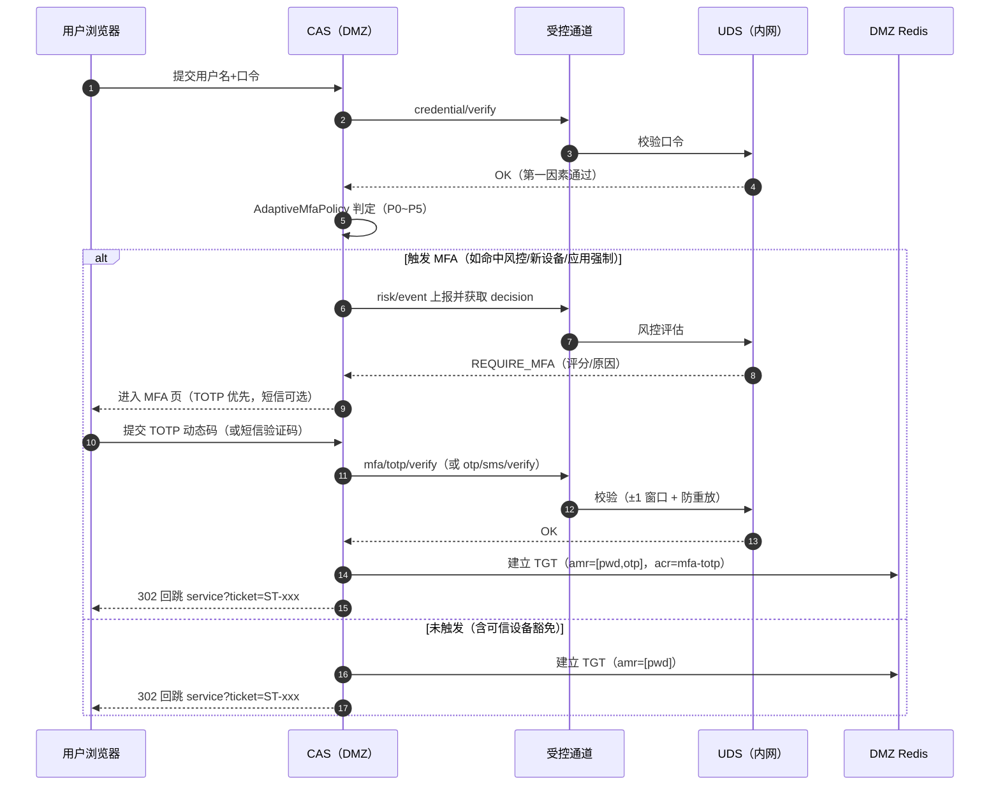
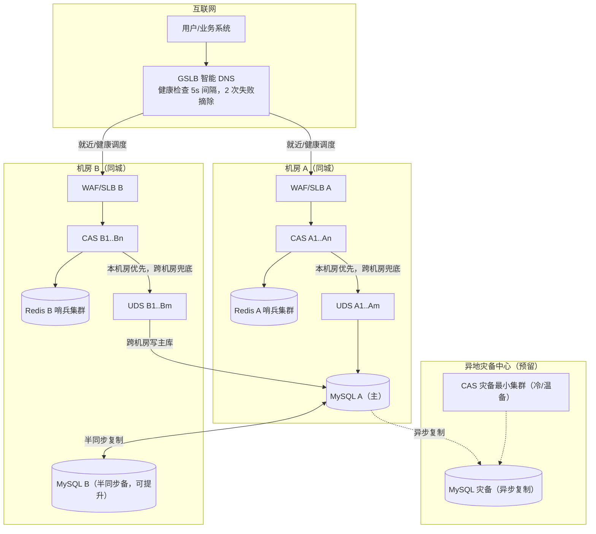
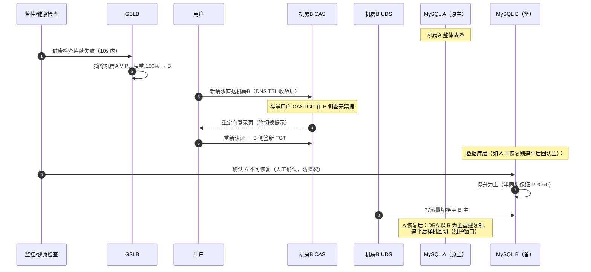

# 新一代统一认证平台 详细设计说明书

| 项目 | 内容 |
|------|------|
| 文档名称 | 新一代统一认证平台 详细设计说明书 |
| 文档编号 | UAP-DD-002 |
| 版本 | V1.0 |
| 状态 | 评审稿 |
| 密级 | 内部公开（含网络分区与安全设计，限项目组及评审专家传阅） |
| 关联文档 | 《01-需求规格说明书》（UAP-SRS-001） |
| 技术基线 | Apereo CAS 6.6.x（JDK 11） |
| 编制日期 | 2026-11-13 |

**修订记录**

| 版本 | 日期 | 修订内容 | 作者 |
|------|------|----------|------|
| V0.1 | 2026-11-01 | 初稿，搭建章节框架 | 架构组 |
| V0.9 | 2026-11-10 | 完成全部章节内部评审修订 | 架构组 |
| V1.0 | 2026-11-13 | 评审稿发布 | 架构组 |

---

# 1. 引言

## 1.1 编写目的

本文档是"新一代统一认证平台"（下称 UAP，Unified Authentication Platform）的详细设计说明书，承接《01-需求规格说明书》中定义的功能需求与非功能需求，将需求逐条落实为可开发、可部署、可验收的技术设计。本文档的读者包括：

- 项目评审专家：评估架构合理性、安全性与可落地性；
- 开发团队：依据本文档进行 CAS Overlay 定制开发、UDS 服务开发、前端登录页改造；
- 网络与安全团队：依据防火墙策略矩阵实施网络分区与受控通道；
- 运维团队：依据部署拓扑、监控指标、应急预案建设运维体系；
- 测试团队：依据协议兼容矩阵、迁移 checklist 设计测试用例。

## 1.2 项目背景与范围

客户现网运行一套 CAS 3.x 时代的 Apereo CAS 统一认证系统，承载全公司业务系统的单点登录（SSO）。该系统存在版本过老（社区已停止维护）、不支持现代协议（OIDC/SAML2）、不支持多因素认证、移动端体验缺失、单机部署可用性不足等问题。本项目目标是在 **Apereo CAS 6.6.x 及以上** 技术基线上重建统一认证平台，并引入以下核心能力：

1. 移动端认证：H5 自适应登录页、扫码登录、短信验证码登录；
2. 多协议支持：CAS v2/v3、OAuth 2.0 / OpenID Connect、SAML 2.0 IdP；
3. 多因素认证（MFA）：TOTP、短信二次验证、按应用/风险策略触发、可信设备；
4. 零信任网络分区：CAS Server 部署于外网接入区（DMZ），敏感用户数据全部收敛至内网"用户认证数据服务"（UDS），DMZ 不落任何敏感数据；
5. 多机房高可用：同城双活起步，可扩展异地灾备；
6. 平滑兼容：现有业务系统仅需修改统一认证地址（CAS server URL 前缀），业务代码零改动。

本文档覆盖上述全部范围的设计，不包含：业务系统自身改造（仅需改地址）、统一用户管理后台的完整业务设计（属 UDS 管理台范畴，本文档仅给出与认证链路的接口边界）、短信网关/CA 等第三方服务的内部实现。

## 1.3 术语与缩略语

| 术语 | 全称/含义 | 说明 |
|------|-----------|------|
| UAP | Unified Authentication Platform | 本项目：新一代统一认证平台 |
| CAS | Central Authentication Service | Apereo 开源 SSO 协议及服务器实现 |
| UDS | User Data Service | 用户认证数据服务，部署于内网核心数据区，集中管理全部敏感用户数据 |
| DMZ | Demilitarized Zone | 外网接入区/隔离区，直接面向互联网 |
| SSO | Single Sign-On | 单点登录 |
| TGT | Ticket Granting Ticket | CAS 会话票据，缓存在用户浏览器 Cookie 中 |
| ST | Service Ticket | 服务票据，一次性，用于业务系统换取用户身份 |
| PGT/PGTIOU | Proxy Granting Ticket (IOU) | 代理票据，用于 CAS 代理模式 |
| MFA | Multi-Factor Authentication | 多因素认证 |
| TOTP | Time-based One-Time Password | 基于时间的一次性口令（RFC 6238） |
| OIDC | OpenID Connect | 基于 OAuth 2.0 的身份层协议 |
| IdP / SP | Identity Provider / Service Provider | 身份提供方 / 服务提供方（SAML 语境） |
| JWKS | JSON Web Key Set | OIDC 签名公钥集发布格式 |
| GSLB | Global Server Load Balancing | 全局负载均衡（跨机房 DNS 智能调度） |
| SLB | Server Load Balancing | 本地负载均衡（四层/七层） |
| WAF | Web Application Firewall | Web 应用防火墙 |
| mTLS | Mutual TLS | 双向 TLS 认证 |
| HSTS | HTTP Strict Transport Security | HTTP 严格传输安全 |
| PIPL | 个人信息保护法 | Personal Information Protection Law |
| 等保 2.0 | 网络安全等级保护 2.0 | GB/T 22239-2019 系列标准 |
| RPO / RTO | Recovery Point/Time Objective | 数据恢复点目标 / 业务恢复时间目标 |
| P95/P99 | 95/99 分位响应时间 | 性能指标统计口径 |
| Break Glass | 应急破窗机制 | 极端故障下的受控应急访问通道 |

## 1.4 参考资料

| 序号 | 资料 | 版本/说明 |
|------|------|-----------|
| 1 | Apereo CAS 官方文档 | 6.6.x 系列文档（https://apereo.github.io/cas/6.6.x/） |
| 2 | Apereo CAS 官方文档 | 7.0.x/7.1.x 系列文档（用于版本对比论证） |
| 3 | CAS Protocol Specification | https://apereo.github.io/cas/6.6.x/protocol/CAS-Protocol-Specification.html |
| 4 | OpenID Connect Core 1.0 | https://openid.net/specs/openid-connect-core-1_0.html |
| 5 | SAML 2.0 OASIS 标准集 | saml-core-2.0-os 等 |
| 6 | RFC 6238 | TOTP: Time-Based One-Time Password Algorithm |
| 7 | RFC 6749 / 6750 / 8414 | OAuth 2.0 Framework / Bearer Token / Authorization Server Metadata |
| 8 | Spring Boot | 2.7.x（CAS 6.6.x 基线）、3.x（CAS 7.x 基线） |
| 9 | GB/T 22239-2019 | 网络安全等级保护基本要求（第三级） |
| 10 | 《01-需求规格说明书》 | UAP-SRS-001 V1.0 |

## 1.5 与需求规格说明书的对应关系

本文档章节与《01-需求规格说明书》需求条目的对应关系在附录 E 给出追溯矩阵。总体上：功能需求 FR-01~FR-09 对应第 5~8 章；安全需求 SR-01~SR-08 对应第 4、10 章；可用性需求 AR-01~AR-05 对应第 9 章；兼容性需求 CR-01~CR-03 对应第 6、11 章；性能需求 PR-01~PR-04 对应第 12 章；运维需求 OR-01~OR-06 对应第 13 章。

---

# 2. 总体架构

## 2.1 设计原则

1. **敏感数据最小化（Data Minimization）**：DMZ 侧 CAS 不存储任何口令哈希、手机号、身份证号等敏感用户数据；敏感数据唯一权威源是内网 UDS。
2. **零信任分区（Zero-Trust Segmentation）**：DMZ 与内网之间无默认信任；所有跨区调用经防火墙白名单 + mTLS + 接口签名/Token 鉴权 + 限流 + 报文级审计五重控制。
3. **应用无状态（Stateless Application）**：CAS 应用节点无任何本地会话状态，TGT/票据外置 Redis，节点可任意增删、故障可秒级摘除。
4. **协议标准优先（Standards First）**：以标准 CAS v2/v3、OIDC、SAML2 协议对外服务，不发明私有协议；老客户端零代码改动。
5. **定制最小侵入（Minimal Invasive Customization）**：所有 CAS 定制收敛于独立 Overlay 工程的扩展点（AuthenticationHandler、PrincipalResolver、风险策略 Bean 等），不改 CAS 源码，保留升级通道。
6. **双活优先、灾备可扩展（Active-Active First）**：同城双机房对等承载流量，架构预留异地灾备扩展位。
7. **可观测内建（Observability Built-in）**：指标、日志、链路追踪在架构期定义，不留到运维期补。

## 2.2 总体分层架构



**数据落点速览**：口令哈希、手机号明文、身份证号、TOTP 密钥只存在于内网 L5/L6；DMZ L3 仅存票据（TGT/ST）、扫码登录临时状态、限流计数器及脱敏后的登录页渲染数据。

## 2.3 核心设计决策清单

| 编号 | 决策点 | 最终决策 | 备选方案 | 决策理由 |
|------|--------|----------|----------|----------|
| AD-01 | CAS 版本 | **CAS 6.6.x（JDK 11）** | CAS 7.x（JDK 17） | 6.6.x 为 CAS 6 最终维护线，生产案例充分，依赖（Spring Boot 2.7）与现有中间件生态兼容，定制扩展点文档成熟；7.x 的 Jakarta 命名空间迁移使全部定制代码需重写适配，项目期风险高。详见第 3 章 |
| AD-02 | 敏感数据位置 | **全部收敛至内网 UDS，DMZ 零敏感数据** | DMZ 部署只读副本库 | DMZ 被穿透时的数据泄露面归零；只读副本虽可提升性能，但将口令哈希/手机号暴露于 DMZ，违反等保与 PIPL 最小化原则 |
| AD-03 | 凭证校验方式 | **自定义 AuthenticationHandler 远程调用 UDS** | CAS 直连 DMZ 只读库 / LDAP | 配合 AD-02；UDS 接口层可同时承载限流、风控联动、审计，避免 DMZ 侧逻辑膨胀 |
| AD-04 | 会话/票据存储 | **Redis Ticket Registry，票据对象 AES-256-GCM 加密后写入** | Hazelcast / Memcached / 本地内存 | Redis 哨兵/集群模式成熟，支持跨机房拓扑；加密写库保证即使 Redis 被拖库也无法伪造会话；本地内存破坏无状态原则 |
| AD-05 | 高可用模式 | **同城双活 + GSLB 就近调度，预留异地灾备** | 主备冷切 | 双活使任一机房故障时用户仅损失已签发票据（重新认证即可），无切换等待；冷备 RTO 不可接受（见《01-需求规格说明书》可用性章节） |
| AD-06 | Redis 跨机房策略 | **机房独立 + 故障降级重认证（一期），评估期保留跨机房异步复制选项** | 跨机房同步复制 | 票据属短期会话数据，丢失代价仅为用户重新登录；同步复制的 RTT 放大登录链路延迟，且引入脑裂复杂度。详见 9.4 节权衡分析 |
| AD-07 | 数据库复制 | **半同步复制（Semi-Sync）主备 + 同城双中心，异地异步复制** | 全同步 / MGR 组复制 | 半同步在 RPO≈0 与写入延迟间取得平衡；MGR 对网络抖动敏感，跨机房写一致性收益不抵运维复杂度 |
| AD-08 | DMZ→内网鉴权 | **mTLS + 接口签名（HMAC-SHA256 带时间戳 nonce）+ OAuth2 Client Credentials Token 三因子组合** | 仅 mTLS / 仅 API Key | mTLS 管通道，Token 管主体身份，签名管单报文防重放与完整性；三者正交叠加，任一被绕过仍有两道防线 |
| AD-09 | 扫码登录实现 | **CAS Overlay 内嵌扫码模块（QR 状态外置 Redis）** | 独立扫码微服务 | 扫码本质是登录流程的状态机变体，与 CAS 登录会话（TGT 建立）强耦合；独立服务会引入第二次跨服务会话对齐，复杂度反而更高 |
| AD-10 | 短信下发 | **UDS 内网代理调用短信网关，DMZ 不接触网关凭证** | DMZ 直连短信网关 | 网关 AK/SK 属高价值凭证，按敏感数据原则留内网；同时便于内网侧实施防刷与审计 |
| AD-11 | 构建方式 | **CAS WAR Overlay（Gradle Overlay Template 6.6.x 分支）+ 内部 Nexus 制品库** | 源码 fork 构建 / Docker 镜像直改 | Overlay 是官方推荐定制方式，升级仅需变更依赖版本号；fork 源码将永久背负合并成本 |
| AD-12 | 接入审批 | **Service Registry（JPA/JSON）+ 工单审批流后由管理平台写入** | 直接改配置文件发布 | 服务注册即授权边界，必须经审批留痕；JPA 模式支持运行时动态加载，无需重启 |

## 2.4 架构风险全景（摘要）

主要架构级风险及缓解路径：UDS 成为全链路单点（缓解：UDS 多机房集群 + CAS 侧熔断降级，见 5.3、9.6）；DMZ→内网通道被滥用（缓解：五重控制 + 白名单最小化，见 4.4）；Redis 故障导致全量票据失效（缓解：哨兵/集群高可用 + 降级重认证体验优化，见 9.4）；CAS 6.6.x 生命周期终点（缓解：定制隔离 + 2027 年评估升级 CAS 7.x 路线图，见 3.6）。完整风险登记表见第 14 章。

---

# 3. 技术选型与版本论证

## 3.1 CAS 6.6.x 与 CAS 7.x 对比论证

版本选型是本项目最重要的技术决策之一（对应决策 AD-01）。以下从维护周期、运行时依赖、安全基线、功能能力、定制成本五个维度对比。

### 3.1.1 对比表

| 维度 | CAS 6.6.x | CAS 7.0.x / 7.1.x | 本项目影响评估 |
|------|-----------|-------------------|----------------|
| 系列定位 | CAS 6 最终维护线（bugfix 分支） | 新一代主版本线 | 6.6.x 变更冻结度高，行为可预期 |
| JDK 要求 | JDK 11（最低），兼容 JDK 17 运行 | JDK 17 强制 | 客户中间件/监控 agent 生态以 JDK 11 为主，6.6.x 无环境改造成本 |
| Spring Boot 基线 | Spring Boot 2.7.x（javax.* 命名空间） | Spring Boot 3.x（jakarta.* 命名空间） | 7.x 的 javax→jakarta 迁移使所有自定义 Filter、Interceptor、依赖第三方库需逐一适配验证 |
| 维护周期 | 社区对 6.6.x 提供维护性修复，覆盖至 7.x 稳定后的过渡期（官方 EOL 策略以发布页为准，6.6 线实际维护窗口覆盖本项目交付与质保期） | 7.x 为社区主线，长期演进方向 | 6.6.x 覆盖本项目 3 年生命周期；同时预留 7.x 升级路线图（见 3.6） |
| 协议能力 | CAS v1/v2/v3、OIDC（OP）、OAuth2、SAML2 IdP、WS-Fed 全部支持 | 同等能力，OIDC 实现更新 | 两者均完整满足《01-需求规格说明书》多协议需求，无功能级差异 |
| MFA 能力 | TOTP（Google Authenticator）、短信/邮件（Simple MFA）、FIDO2/WebAuthn、Duo 等全谱系；MFA 触发策略（Groovy/按应用/按主体属性）成熟 | 同等能力，配置项少量重命名 | 6.6.x 的 MFA 触发链文档与生产案例更充分 |
| 扫码登录 | 无官方开箱模块，需自研（本项目自研 QR 模块） | 同样无官方开箱模块 | 两者均需自研，成本相同 |
| 扩展点 API | AuthenticationHandler、PrincipalResolver、AuthenticationEventExecutionPlan 等接口在 6.x 线内稳定 | 同名接口签名有破坏性调整（包名 jakarta 化、部分接口方法变更） | 6.6.x 上定制代码可直接参考大量公开样例；7.x 需重新验证 |
| 生产案例 | 全球大量高校/企业生产部署，中文社区资料丰富 | 案例积累中 | 降低疑难问题排查成本 |
| 依赖漏洞暴露面 | Spring Boot 2.7 持续获得商业/社区补丁（需注意其上游 OSS 维护节奏） | Spring Boot 3.x 上游主线维护 | 通过内部制品库统一管控依赖版本与补丁升级，风险可控 |

### 3.1.2 推荐结论

**推荐采用 Apereo CAS 6.6.x（锁定小版本 ≥ 6.6.15，构建时以内部制品库 pin 的最新 6.6.x 补丁版本为准），JDK 11。**

理由：在满足全部功能需求（多协议、MFA、移动端）的前提下，CAS 6.6.x 的扩展点 API 稳定、生产案例充分、与 JDK 11 基础设施零摩擦，可将定制开发与生产运行风险降至最低；CAS 7.x 的 Spring Boot 3 / Jakarta 迁移收益（长期演进性）不抵其在项目期内引入的适配与验证成本。全部定制代码将按 5.2 节的隔离原则收敛于独立模块，为质保期后升级 CAS 7.x 保留通道。

## 3.2 配套技术选型

| 类别 | 选型 | 版本基线 | 选型理由 |
|------|------|----------|----------|
| 应用运行时 | OpenJDK（Temurin） | 11.0.x | CAS 6.6.x 官方基线；Temurin 提供长期补丁 |
| 构建方式 | CAS WAR Overlay（Gradle） | cas-overlay-template 6.6 分支 | 官方推荐定制方式，升级仅需改版本号；产物为可执行 WAR（内嵌 Tomcat 9.x） |
| 票据/会话存储 | Redis | 6.2+ / 7.x，哨兵模式起步 | 官方 Ticket Registry 一等支持；哨兵提供机房内自动主备切换 |
| 关系数据库 | MySQL 8.0（备选 PostgreSQL 14+） | 8.0.3x | 内网 UDS 主存储；半同步复制成熟；客户 DBA 生态以 MySQL 为主 |
| UDS 服务框架 | Spring Boot | 2.7.x（与 CAS 同基线） | 技术栈统一，降低团队上下文切换 |
| 负载均衡（机房内） | 既有 SLB/F5 | 七层 HTTPS | 复用现有设施；七层支持按路径路由（/cas/*） |
| 全局调度 | GSLB（智能 DNS） | 既有 GSLB 服务 | 按用户来源调度至就近机房；健康检查失败自动摘除 |
| WAF | 既有 WAF 集群 | — | 复用；为认证平台配置专属防护策略（见 10.3） |
| 容器/部署 | 物理机/虚拟机 + systemd | — | 一期不引入 K8s，降低网络分区下的编排复杂度；安装包+配置中心方式发布 |
| 配置中心 | Nacos（内网）+ 分区下发 | 2.x | CAS 各机房差异化配置下发；DMZ 侧配置经只读通道下发（见 13.1） |
| 监控 | Prometheus + Grafana + 既有告警平台 | — | 黄金指标体系见 13.2 |
| 链路追踪 | OpenTelemetry Agent | 1.x | CAS 与 UDS 统一埋点，端到端追踪登录链路 |
| 短信网关 | 客户既有企业短信网关 | — | 经 UDS 代理调用，DMZ 不接触网关凭证 |

## 3.3 版本锁定与补丁策略

1. 构建时通过 `gradle.properties` 锁定 `cas.version=6.6.x`（具体小版本以立项时内部制品库扫描无高危漏洞的最新版为准），`spring-boot.version` 跟随 CAS BOM，不单独升级。
2. 所有第三方依赖经内部 Nexus 代理仓进入，安全扫描（SCA）作为 CI 卡点；高危漏洞按 10.1 节的补丁 SLA 处置。
3. CAS 小版本升级（6.6.x → 6.6.y）只需修改版本号并重跑回归测试集（协议兼容 + 登录主流程 + MFA），预计工作量集中在 Overlay 扩展点编译验证。

## 3.4 JDK 运行时参数基线

```bash
JAVA_OPTS="-server -Xms4g -Xmx4g -XX:+UseG1GC -XX:MaxGCPauseMillis=200 \
  -XX:+HeapDumpOnOutOfMemoryError -XX:HeapDumpPath=/data/logs/cas/ \
  -Dfile.encoding=UTF-8 -Duser.timezone=Asia/Shanghai \
  -Djava.security.egd=file:/dev/./urandom \
  --add-opens java.base/java.lang=ALL-UNNAMED"
```

说明：G1GC 配合 4G 堆可支撑单节点 2000 TPS 登录峰值（见 12.3 估算）；票据序列化依赖随机数源，显式指定非阻塞 urandom 避免熵耗尽导致登录卡顿。

## 3.5 依赖组件端口与部署形态汇总

详见附录 A 端口与防火墙矩阵汇总表。

## 3.6 演进路线图（CAS 7.x 预留）

质保期内（交付后 3 年）运行 6.6.x；第 24 个月启动 CAS 7.x 评估：届时若 7.x 生态成熟且 JDK 17 基础设施就绪，按 5.2 节定制隔离清单逐项适配迁移，预估迁移范围为 Overlay 模块重新编译 + 配置项重命名核对 + 全量回归。本设计所有自研接口（UDS API、QR 状态机）与 CAS 版本解耦，迁移不影响内网侧。

---

# 4. 网络分区与安全隔离设计（核心）

本章是本项目安全架构的灵魂，落实《01-需求规格说明书》安全需求章节"DMZ 无敏感数据、内网数据服务化、通道受控"的硬约束。

## 4.1 分区模型

网络划分为四个安全区，区间默认拒绝（Default Deny），按需白名单放通：

| 分区 | 安全级别 | 部署内容 | 数据敏感度 |
|------|----------|----------|------------|
| 互联网区（Untrusted） | 无信任 | 用户终端、业务系统服务端 | — |
| DMZ 外网接入区 | 低信任（可被穿透假设） | WAF、SLB、CAS Server 集群、DMZ Redis | 仅票据/会话/脱敏属性，无敏感用户数据 |
| 内网应用区（受信） | 高信任 | UDS 集群、管理平台、审计采集器 | 敏感用户数据的处理与转发 |
| 内网数据区（核心） | 最高信任 | MySQL 主备、UDS 缓存、短信网关接入 | 敏感用户数据的权威存储 |

**核心假设（Assume Breach）**：设计假设 DMZ 内任一组件（含 CAS 节点、DMZ Redis）可能被攻击者完全控制。在此假设下，平台须保证：攻击者无法获得任何用户口令（含哈希）、手机号明文、身份证号、TOTP 密钥；无法借助 DMZ 立足点批量拉取内网数据（受 4.4 通道控制约束）；无法伪造合法用户会话（票据加密 + ST 一次性 + 短 TTL）。

## 4.2 分区拓扑图



## 4.3 DMZ 无敏感数据设计

### 4.3.1 DMZ 侧数据资产清单（字段级）

DMZ 侧允许存在的全部数据及其字段如下，除此之外任何用户数据不得写入 DMZ 存储：

| 存储位置 | 数据对象 | 字段明细 | 敏感级别 | 保护措施 | TTL |
|----------|----------|----------|----------|----------|-----|
| DMZ Redis | TGT 会话对象（加密） | 票据 ID、Principal ID（ opaque 化，见下）、认证时间、认证方式（acr）、已发布属性快照（**仅脱敏后字段**）、MFA 完成标记 | 中 | 整体 AES-256-GCM 加密（密钥由 KMS 管理，见 10.1）；密钥不落 DMZ 磁盘明文 | 默认 8h（滑动） |
| DMZ Redis | ST 服务票据 | 票据 ID、TGT 引用、Service URL、签发时间 | 低 | 一次性使用，校验后即焚 | 10s（CAS 默认） |
| DMZ Redis | PGT/PGTIOU | 代理票据映射 | 中 | 同 TGT 加密 | 同 TGT |
| DMZ Redis | 扫码登录状态 | qrId、状态机枚举（见 7.1）、绑定会话指纹、确认后的一次性换票凭证 | 低 | 一次性凭证随机 256bit，使用后即焚 | 二维码 120s |
| DMZ Redis | 限流/防爆破计数器 | 来源 IP 计数、账号模糊指纹（HMAC 化的登录名，不可反推）、失败次数 | 低 | 登录名经 HMAC-SHA256（密钥 DMZ 本地随机生成，重启即换）后作为 key | 窗口 10min |
| DMZ Redis | 幂等与防重放 nonce | DMZ→内网签名用 nonce 缓存 | 低 | — | 5min |
| CAS 节点内存 | 登录页渲染数据 | 服务名、主题参数、错误码 | 无 | — | 请求生命周期 |
| CAS 节点磁盘 | 应用日志 | 按 13.4 日志规范，**禁止输出口令、验证码、完整手机号**；手机号字段掩码为 `138****8000` 形式 | 低 | 日志脱敏 PatternLayout 强制掩码规则 | 按留存策略 |
| 浏览器 Cookie | TGC（CASTGC） | 票据 ID 引用（不透明随机串） | 中 | HttpOnly、Secure、SameSite=Lax、路径限定 /cas | 会话级/8h |
| 浏览器 Cookie | 可信设备指纹 | 设备指纹 ID + HMAC 签名 | 低 | 签名密钥与 TGT 加密密钥分离 | 30d |

**Principal ID opaque 化**：CAS 内部以登录名作为 Principal 标识。为防 DMZ 数据泄露时直接暴露用户账号体系，TGT 对象中存储的 Principal ID 为 `HMAC-SHA256(登录名, DMZ_K1)` 的不透明串（K1 由 KMS 下发、仅存 DMZ 应用内存）；登录名明文仅在登录请求处理生命周期内存在于内存，不落盘、不入日志。验票应答（serviceValidate 返回的 `<cas:user>`）需还原明文登录名，由 CAS 在响应渲染阶段经 UDS 属性查询接口附带返回，不存 DMZ。

### 4.3.2 敏感数据负面清单（DMZ 绝对禁止）

以下数据项**绝不允许**出现在 DMZ 任何存储介质（含 Redis、磁盘、日志、环境变量）：

1. 用户口令及其哈希（任何形式的口令材料）；
2. 手机号明文（登录页回填场景仅显示掩码形式，掩码由 UDS 完成）；
3. 身份证号、姓名等身份信息（属性发布采用白名单制，默认仅发布登录名与脱敏显示名，见 5.4）；
4. TOTP 密钥（种子）——注册与校验均在内网完成，DMZ 仅转发六位动态码；
5. 短信验证码明文——DMZ 侧提交即转发，校验结果由内网返回布尔值；
6. 短信网关 AK/SK、数据库连接凭证、UDS 签名密钥以外任何内网凭证；
7. 身份证号、银行卡号等监管明确的敏感个人信息。

**落地检查手段**：CI 阶段对 Overlay 工程配置与代码做敏感关键字静态扫描；运行期 DMZ Redis 抽样审计脚本每日比对字段白名单；DMZ 节点磁盘挂载只读根分区（应用仅可写 /data/logs 与临时目录）。

## 4.4 DMZ→内网受控通道设计

### 4.4.1 五重控制叠加

DMZ CAS 调用内网 UDS 的全部流量经过唯一受控通道，叠加五重控制：

1. **防火墙白名单（网络层）**：仅允许 DMZ CAS 节点 IP 段 → UDS 接入网关 VIP 的 tcp/8443， deny 其余一切；反向（内网→DMZ）仅允许管理平台→DMZ 配置下发通道与监控采集通道（见 4.6 矩阵）。
2. **mTLS 双向认证（传输层）**：CAS 侧持客户端证书（CN=uap-cas-dmz，由内部私有 CA 签发，有效期 1 年，自动轮换流程见 10.1）；UDS 接入网关校验客户端证书 CN 与 IP 白名单一致性；UDS 服务端证书供 CAS 校验防中间人。
3. **Token 主体鉴权（应用层-主体）**：CAS 以 OAuth2 Client Credentials 模式向 UDS 的 Token 端点换取短期访问令牌（client_id/client_secret 由密钥管理系统分发，secret 存 DMZ 节点本地密钥文件，权限 600，与代码制品分离下发）；所有业务接口调用须携带 Bearer Token，Token 有效期 300s，UDS 侧校验 audience、scope（按接口最小授权，见 4.5 API 表）。
4. **接口签名（应用层-报文）**：关键写接口与凭证校验接口在 Token 之外叠加报文级签名——`X-Sign = HMAC-SHA256(签名密钥, method + path + sortedQuery + bodySHA256 + timestamp + nonce)`；timestamp 偏差超过 ±120s 拒绝；nonce 5 分钟内不得重复（UDS 侧 nonce 缓存）。签名密钥与 Token secret 分离管理。该层防御 Token 泄露后的重放与篡改。
5. **限流与熔断（应用层-流量）**：UDS 侧按 client_id + 接口维度令牌桶限流（阈值见 4.5 表）；CAS 侧配置 Resilience4j 熔断器（见 5.3.3），异常比例超阈值自动熔断并进入降级。

### 4.4.2 报文级审计

所有 DMZ→内网调用在 UDS 接入层记录审计报文摘要：

| 审计字段 | 说明 |
|----------|------|
| traceId | 端到端追踪 ID（CAS 生成，贯穿 OTel 链路） |
| timestamp | 请求时间（毫秒） |
| clientCertCN | mTLS 证书主体 |
| clientId / scopes | Token 主体与授权范围 |
| interface | 接口标识（如 `credential.verify`） |
| requestDigest | 请求报文关键字段摘要（**口令字段只记录 HMAC 摘要，禁止原文**） |
| resultCode / latency | 结果与耗时 |
| srcIp / dstNode | 来源与落点 |
| riskFlags | 风控标记（异地、异常频率等） |

审计日志本地留存 7 天后归档至内网日志平台，留存 3 年（满足等保三级审计留存要求）。审计管道与业务管道物理隔离（独立日志通道），防止业务高峰期审计丢失。

### 4.4.3 通道故障行为定义

| 故障场景 | 系统行为 |
|----------|----------|
| mTLS 证书过期/校验失败 | CAS 侧快速失败，登录页提示系统维护中；触发 P1 告警；证书轮换采用双证书平滑期避免此场景（10.1.3） |
| Token 端点不可达 | 熔断器开启，登录请求进入降级（拒绝新认证，已持有 TGT 的用户不受影响） |
| UDS 全集群不可达 | DMZ 无本地敏感数据可供降级校验——**设计明确：不做本地降级校验**，宁可拒绝登录也不放松凭证校验到 DMZ；配合 9.6 应急预案 |
| 单机房 UDS 不可达 | CAS 优先路由本机房 UDS，失败后跨机房重试（UDS 双活接入 VIP 双注册），见 9.3 |

## 4.5 UDS 服务接口设计（API 清单）

UDS 对内网管理平台开放管理 API（本文略，属管理平台范畴），对 DMZ CAS 仅开放下表 8 个受控接口。所有接口路径前缀 `/uds/v1`，强制 HTTPS+mTLS+Token+（标注签名者）接口签名。

### 4.5.1 凭证校验接口

| 项 | 内容 |
|----|------|
| 方法/路径 | `POST /uds/v1/credential/verify` |
| 用途 | 校验用户名+口令，返回校验结果与脱敏身份摘要 |
| 鉴权 | mTLS + Token(scope=credential:verify) + 接口签名 |
| 限流 | 每 CAS 节点 200 TPS，全局 2000 TPS；同账号指纹 10 次/10min（超限触发风控） |
| 入参 | `{ "loginId": "zhangsan", "password": "明文口令(仅 mTLS 通道内传输,UDS 收到后立即与库内 Argon2id 哈希比对并擦除内存)", "clientIp": "...", "userAgent": "...", "requestId": "..." }` |
| 出参 | `{ "code": "OK\|INVALID_CREDENTIAL\|LOCKED\|DISABLED\|PASSWORD_EXPIRED", "opaqueUid": "UDS 侧用户主键不透明串", "displayName": "张*（脱敏显示名）", "maskedMobile": "138****8000", "remainingAttempts": 4, "passwordExpiringInDays": 12 }` |
| 关键设计 | 口令仅在 mTLS 加密通道内以明文形态存在一跳（CAS→UDS），UDS 使用 Argon2id（m=64MB,t=3,p=4）比对，比对后立即清零内存缓冲区；口令绝不落任何日志；锁定/剩余次数由 UDS 统一计数（DMZ 计数仅做粗粒度预挡） |

### 4.5.2 用户属性查询接口

| 项 | 内容 |
|----|------|
| 方法/路径 | `POST /uds/v1/user/attributes` |
| 用途 | CAS 登录成功后按服务授权范围查询可发布属性（attribute release 数据源） |
| 鉴权 | mTLS + Token(scope=attribute:read) + 接口签名 |
| 限流 | 每节点 500 TPS，全局 5000 TPS |
| 入参 | `{ "opaqueUid": "...", "serviceId": "https://app.example.com/xxx", "requestedAttributes": ["displayName","email","deptCode"] }` |
| 出参 | `{ "code": "OK", "attributes": { "displayName": "张*", "email": "z***@example.com", "deptCode": "D1024" }, "policyVersion": "v17" }` |
| 关键设计 | UDS 内置属性发布策略引擎：按 serviceId 匹配授权属性集（与服务注册信息联动），未授权属性直接剔除；敏感字段（手机号等）默认脱敏，仅当服务注册时审批声明"确需明文"且合规备案后才放行明文 |

### 4.5.3 MFA-TOTP 密钥读写接口

| 接口 | 方法/路径 | 用途 | 鉴权/签名 | 限流 | 核心出入参 |
|------|-----------|------|-----------|------|------------|
| TOTP 注册初始化 | `POST /uds/v1/mfa/totp/enroll/begin` | 为用户生成 TOTP 种子并返回 otpauth:// 二维码内容 | Token(scope=mfa:write)+签名 | 10 TPS/节点 | 入：`opaqueUid`；出：`secretQrUri`（二维码内容经一次性返回，UDS 仅存加密种子）、`enrollToken`（注册会话凭证，5min 有效） |
| TOTP 注册确认 | `POST /uds/v1/mfa/totp/enroll/commit` | 用户输入首个动态码完成绑定 | 同上 | 10 TPS/节点 | 入：`enrollToken`、`otpCode`；出：`OK/FAIL` |
| TOTP 校验 | `POST /uds/v1/mfa/totp/verify` | 校验六位动态码 | Token(scope=mfa:verify)+签名 | 100 TPS/节点 | 入：`opaqueUid`、`otpCode`；出：`OK/FAIL`、`driftWindowUsed` |
| TOTP 解绑 | `POST /uds/v1/mfa/totp/unbind` | 解除绑定（管理/申诉流程） | Token(scope=mfa:write)+签名 | 5 TPS/节点 | 入：`opaqueUid`、`approvalId`（审批单号，强制） |

种子在 UDS 侧以信封加密存储（字段级 KMS 密钥，见 10.1.2）；校验采用 ±1 时间窗（30s 步长）容忍时钟漂移，并记录使用窗口防重放（同一动态码在有效期内仅可使用一次）。

### 4.5.4 MFA-短信验证码代理接口

| 接口 | 方法/路径 | 用途 | 鉴权/签名 | 限流 | 核心出入参 |
|------|-----------|------|-----------|------|------------|
| 验证码下发 | `POST /uds/v1/otp/sms/send` | 生成验证码并经内网短信网关下发至用户绑定手机号 | Token(scope=otp:send)+签名 | 60 TPS/节点；**同手机号 1 条/min、5 条/h、10 条/d**；同 IP 20 条/h | 入：`opaqueUid` 或 `maskedMobile + loginIdHash`（登录场景）、`scene`（login/mfa/bind）、`captchaToken`（图形/行为验证码通过后签发的防刷凭证）；出：`OK/RATE_LIMITED/CAPTCHA_REQUIRED`、`maskedMobile`、`expireSeconds:300` |
| 验证码校验 | `POST /uds/v1/otp/sms/verify` | 校验用户提交的验证码 | Token(scope=otp:verify)+签名 | 100 TPS/节点；同验证码错误 5 次即作废 | 入：`scene`、`opaqueUid`、`otpCode`、`sendSeq`（下发流水号）；出：`OK/INVALID/EXPIRED/ATTEMPTS_EXCEEDED` |

验证码生成、存储（Redis 内网实例，哈希存储）、比对、失效全部在内网完成；DMZ 收到的只有布尔结果。防刷细节见 7.2.3。

### 4.5.5 登录风控事件上报接口

| 项 | 内容 |
|----|------|
| 方法/路径 | `POST /uds/v1/risk/event` |
| 用途 | CAS 上报登录上下文（IP、UA、设备指纹、异地标记），UDS 风控引擎返回风险评分与处置建议 |
| 鉴权 | mTLS + Token(scope=risk:write)（只写接口，免签名，但保留 nonce 防重放） |
| 限流 | 500 TPS/节点 |
| 入参 | `{ "opaqueUid": "...", "clientIp": "...", "geo": "...", "ua": "...", "deviceFp": "...", "eventType": "LOGIN_ATTEMPT\|LOGIN_SUCCESS\|LOGIN_FAIL" }` |
| 出参 | `{ "riskScore": 72, "decision": "ALLOW\|REQUIRE_MFA\|DENY", "reasons": ["NEW_DEVICE","GEO_CHANGE"] }` |
| 关键设计 | 评分与策略模型属内网风控子系统；CAS 仅消费 decision。该接口为 MFA 触发策略的数据源之一（见 8.4） |

### 4.5.6 口令修改接口

| 项 | 内容 |
|----|------|
| 方法/路径 | `POST /uds/v1/credential/change` |
| 用途 | 用户自助修改口令（旧口令校验 + 新口令强度检查 + 历史口令去重） |
| 鉴权 | mTLS + Token(scope=credential:write) + 接口签名 |
| 限流 | 20 TPS/节点；同账号 5 次/h |
| 出入参 | 入：`loginId`、`oldPassword`、`newPassword`；出：`OK/WEAK_PASSWORD/OLD_MISMATCH/REUSED` |
| 关键设计 | 新口令强度规则（长度≥10、四选三字符类、弱口令字典、与近 5 次历史不重复）在 UDS 侧统一执行 |

### 4.5.7 账号状态查询接口（轻量）

| 项 | 内容 |
|----|------|
| 方法/路径 | `POST /uds/v1/user/status` |
| 用途 | 扫码登录确认、MFA 前置检查等场景查询账号是否可用（不校验口令） |
| 鉴权 | mTLS + Token(scope=user:read) |
| 限流 | 300 TPS/节点 |
| 出入参 | 入：`loginIdHash`；出：`status: NORMAL/LOCKED/DISABLED`、`mfaEnrolled: ["TOTP","SMS"]` |

### 4.5.8 健康检查接口

`GET /uds/v1/health`：供 CAS 熔断器与运维探测使用，免 Token 但限 mTLS 白名单，返回组件级健康度（DB、缓存、短信网关代理）。限流 60 TPS。

### 4.5.9 接口鉴权方式汇总表

| 接口 | mTLS | Token scope | 接口签名 | 报文审计 |
|------|------|-------------|----------|----------|
| credential/verify | 必 | credential:verify | 必 | 必（口令仅 HMAC 摘要） |
| credential/change | 必 | credential:write | 必 | 必 |
| user/attributes | 必 | attribute:read | 必 | 必 |
| mfa/totp/* | 必 | mfa:read/write | 必 | 必 |
| otp/sms/send | 必 | otp:send | 必 | 必 |
| otp/sms/verify | 必 | otp:verify | 必 | 必 |
| risk/event | 必 | risk:write | 免（nonce 防重放） | 必 |
| user/status | 必 | user:read | 免 | 必 |
| health | 必 | 免 | 免 | 抽样 |

## 4.6 防火墙策略矩阵

下表为全平台跨区防火墙策略矩阵（机房 A、B 对称；异地灾备预留）。策略原则：默认全拒，逐条白名单；每条策略注明用途与方向，变更须经安全评审。

| 编号 | 源区 | 源对象 | 目的区 | 目的对象 | 端口/协议 | 方向 | 用途 | 备注 |
|------|------|--------|--------|----------|-----------|------|------|------|
| FW-01 | 互联网 | Any | DMZ | WAF VIP | tcp/443 HTTPS | 入 | 用户与业务系统访问认证平台 | 仅 443；80 仅用于跳转 443 |
| FW-02 | DMZ | WAF 节点 | DMZ | SLB VIP | tcp/443 HTTPS | 区内 | WAF 回源 | 区内策略 |
| FW-03 | DMZ | SLB 节点 | DMZ | CAS 节点 | tcp/8443 HTTPS | 区内 | SLB→CAS 转发 | CAS 容器端口 |
| FW-04 | DMZ | CAS 节点 | DMZ | DMZ Redis | tcp/6379 | 区内 | 票据/状态读写 | Redis 启用 ACL + TLS |
| FW-05 | DMZ | CAS 节点 | 内网应用区 | UDS 接入网关 VIP | **tcp/8443 HTTPS+mTLS** | DMZ→内网 | **唯一业务受控通道** | 五重控制载体 |
| FW-06 | 内网应用区 | UDS 节点 | 内网数据区 | MySQL 主/备 | tcp/3306 | 区内 | 数据存取 | 仅 UDS 服务账号 |
| FW-07 | 内网应用区 | UDS 节点 | 内网应用区 | UDS 缓存 Redis | tcp/6379 | 区内 | 验证码/会话缓存 | 内网实例，与 DMZ Redis 物理分离 |
| FW-08 | 内网应用区 | UDS 节点 | 内网数据区 | 短信网关接入机 | tcp/7890（以网关实际为准） | 区内 | 短信下发 | 走专线/专网 |
| FW-09 | 内网应用区 | 管理平台 | 内网应用区 | UDS 节点 | tcp/8081 HTTPS | 区内 | 管理 API | 管理端双因素登录 |
| FW-10 | 内网应用区 | 配置中心 | DMZ | CAS 节点 | tcp/8848（只读下发通道） | 内网→DMZ | 配置下发 | 通道内容签名验签；DMZ 不可反连 |
| FW-11 | 内网应用区 | 监控采集器 | DMZ | CAS/Redis 节点 | tcp/9100、tcp/9464 | 内网→DMZ | 指标采集 | 仅只读 metrics |
| FW-12 | DMZ | CAS 节点 | 内网应用区 | 日志平台接入 | tcp/5044 TLS | DMZ→内网 | 日志外送 | DMZ 本地日志同时留存 |
| FW-13 | 内网数据区 | MySQL 主 | 内网数据区（同城机房） | MySQL 备 | tcp/3306 | 跨机房 | 半同步复制 | 机房间专线 |
| FW-14 | 内网数据区 | MySQL 主 | 异地灾备区 | MySQL 灾备 | tcp/3306 | 跨地域 | 异步复制 | 异地灾备扩展 |
| FW-15 | 运维区 | 堡垒机 | DMZ/内网 | 各节点 | tcp/22 | 入 | 运维管理 | 全量录屏审计；禁止直连 |
| FW-16 | 互联网 | Any | DMZ | CAS 节点 | Any | 入 | **显式拒绝** | 用户流量必经 WAF/SLB |

**策略要点**：
- DMZ→内网有且仅有 FW-05 一条业务通道与 FW-12 一条日志通道；
- 内网→DMZ 仅配置下发（FW-10）与监控采集（FW-11）两条只读性质通道，DMZ 被穿透后攻击者无法利用反向通道扩大战果；
- 所有跨区策略变更走变更工单 + 双人复核。

## 4.7 登录端到端数据流分析

以下以"用户名+口令登录业务系统"为例，给出端到端数据流及敏感数据边界（扫码与 MFA 流程见第 7、8 章）：



**数据流边界结论**：

| 数据项 | 经过 DMZ？ | 形态 |
|--------|------------|------|
| 用户口令 | 是（浏览器→CAS→UDS 一跳传输） | 仅 TLS/mTLS 通道内，内存态，零落盘 |
| 口令哈希 | **否** | 仅存内网 MySQL |
| 手机号明文 | **否** | 仅存内网；DMZ 仅见 `138****8000` 掩码 |
| 身份证号/姓名明文 | **否** | 默认不发布；白名单审批后仅出内网到对应业务系统（不经 DMZ 存储） |
| TOTP 密钥 | **否** | 内网信封加密存储；DMZ 仅转发六位动态码 |
| 短信验证码 | 传输一跳（用户提交→UDS） | DMZ 不存储不校验 |
| TGT/ST/PGT | 是 | DMZ Redis AES-256-GCM 加密存储；ST 一次性 |
| 用户属性（发布给业务） | 是 | 经授权策略过滤 + 脱敏后的最小集 |
| 扫码状态 | 是 | 随机 qrId 与状态枚举，无身份信息（确认前） |

---

# 5. CAS 定制与扩展设计

## 5.1 定制总体原则与 Overlay 工程结构

遵循 AD-11（最小侵入）：不改 CAS 源码，全部定制通过官方扩展点注入。采用 `cas-overlay-template` 6.6 分支作为构建基线，工程结构如下：

```text
uap-cas-overlay/
├── build.gradle                     # 依赖装配（CAS 模块 BOM + 自研模块）
├── gradle.properties                # cas.version=6.6.x, spring-boot 版本由 BOM 管理
├── settings.gradle
├── src/main/java/com/example/uap/
│   ├── authn/
│   │   ├── UdsAuthenticationHandler.java        # 自定义凭证校验（调 UDS）
│   │   ├── UdsAuthenticationConfiguration.java  # Bean 装配
│   │   ├── UdsClient.java                       # UDS HTTP 客户端（mTLS/Token/签名）
│   │   ├── UdsCircuitBreakerAdvice.java         # 熔断/降级策略
│   │   └── OpaquePrincipalFactory.java          # Principal opaque 化
│   ├── attribute/
│   │   ├── UdsAttributeRepository.java          # 属性仓库（调 UDS 属性接口）
│   │   └── AttributeMaskingReleasePolicy.java   # 脱敏发布策略兜底
│   ├── qr/
│   │   ├── QrLoginController.java               # 扫码登录端点
│   │   ├── QrLoginStateStore.java               # 扫码状态（Redis）
│   │   └── QrLoginWebflowConfigurer.java        # 登录流编排
│   ├── risk/
│   │   ├── AdaptiveMfaPolicy.java               # 风险自适应 MFA 触发策略
│   │   └── TrustedDeviceEvaluator.java          # 可信设备评估
│   └── logging/
│       └── SensitiveDataMaskingConverter.java   # 日志脱敏转换器
├── src/main/resources/
│   ├── application.yml                # CAS 主配置（见 5.7）
│   ├── log4j2.xml                     # 日志规范（脱敏 Pattern）
│   ├── services/                      # Service 注册（文件模式兜底，主用 JPA）
│   │   └── HTTPSandIMAPS-10000001.json
│   ├── themes/uap/                    # 自定义主题（见 5.8）
│   │   ├── templates/
│   │   └── static/
│   └── META-INF/spring.factories      # 自动装配声明
└── src/test/                          # 单元与契约测试（UDS API 契约 mock）
```

构建与制品：`./gradlew clean build` 产出可执行 WAR，CI 流水线执行：编译 → 单测 → SCA 依赖扫描 → 敏感关键字静态扫描 → 镜像/安装包打包 → 制品库归档（版本号=Git Tag）。

## 5.2 定制代码隔离清单（CAS 7.x 迁移预留）

所有定制 Bean 通过 `@AutoConfiguration` + 条件装配注册，对 CAS 内部类的依赖收敛于公开 API 包（`org.apereo.cas.authentication.*`、`org.apereo.cas.services.*`、`org.apereo.cas.ticket.*`、`org.apereo.cas.web.flow.*`）。迁移评估时仅需核对上述包的 API 变更。

## 5.3 自定义 AuthenticationHandler 设计

### 5.3.1 职责与位置

CAS 6.6.x 认证管线由 `AuthenticationEventExecutionPlan` 编排，可注册多个 `AuthenticationHandler`。本设计注册一个 `UdsAuthenticationHandler`（处理 UsernamePasswordCredential），优先级最高，替代默认的静态/LDAP/JDBC Handler；其余 Handler（如管理后台本地应急账号，仅内网管理控制台使用）按需注册。扫码登录与短信验证码登录分别实现独立的 Credential 类型与 Handler（复用 UDS 接口），保证登录方式在认证事件（AuthenticationEvent）中可被区分记录（acr 值差异），为审计与按认证方式授权提供依据。

### 5.3.2 关键代码骨架

```java
package com.example.uap.authn;

import org.apereo.cas.authentication.*;
import org.apereo.cas.authentication.handler.support.AbstractUsernamePasswordAuthenticationHandler;
import org.apereo.cas.authentication.principal.PrincipalFactory;
import org.apereo.cas.services.ServicesManager;

import javax.security.auth.login.AccountLockedException;
import javax.security.auth.login.AccountNotFoundException;
import javax.security.auth.login.FailedLoginException;
import java.security.GeneralSecurityException;
import java.util.ArrayList;
import java.util.Map;

/**
 * 基于内网 UDS 的凭证校验 Handler。
 * DMZ 侧不保存任何用户数据，所有校验通过受控通道调用 UDS 完成。
 */
public class UdsAuthenticationHandler
        extends AbstractUsernamePasswordAuthenticationHandler {

    private final UdsClient udsClient;              // 封装 mTLS/Token/签名/限流客户端
    private final OpaquePrincipalFactory opaqueFactory;

    public UdsAuthenticationHandler(final String name,
                                    final ServicesManager servicesManager,
                                    final PrincipalFactory principalFactory,
                                    final UdsClient udsClient,
                                    final OpaquePrincipalFactory opaqueFactory) {
        super(name, servicesManager, principalFactory, null);
        this.udsClient = udsClient;
        this.opaqueFactory = opaqueFactory;
    }

    @Override
    protected AuthenticationHandlerExecutionResult authenticateUsernamePasswordInternal(
            final UsernamePasswordCredential credential,
            final String originalPassword) throws GeneralSecurityException {

        // 入参防御：超长输入直接拒绝，避免放大攻击
        if (credential.getUsername() == null || credential.getUsername().length() > 64) {
            throw new AccountNotFoundException("invalid username");
        }

        // 远程调用 UDS 凭证校验接口（内部含超时/重试/熔断，见 5.3.3）
        UdsVerifyResponse resp = udsClient.verifyCredential(
                credential.getUsername(),
                originalPassword,               // 仅存在于本调用栈内存，不日志不落盘
                ClientContextHolder.current()   // clientIp/UA/traceId
        );

        switch (resp.getCode()) {
            case OK:
                // Principal 采用 opaque 化标识（HMAC 登录名），属性列表留空，
                // 真正的属性由 PrincipalResolver/AttributeRepository 阶段经 UDS 补齐
                var principal = opaqueFactory.createPrincipal(
                        credential.getUsername(), Map.of(
                                "opaqueUid", resp.getOpaqueUid(),
                                "displayName", resp.getDisplayName(),
                                "maskedMobile", resp.getMaskedMobile()));
                return createHandlerResult(credential, principal, new ArrayList<>());
            case INVALID_CREDENTIAL:
                throw new FailedLoginException("invalid credentials");
            case LOCKED:
                throw new AccountLockedException("account locked");
            case DISABLED:
                throw new AccountNotFoundException("account disabled");
            case PASSWORD_EXPIRED:
                throw new CredentialExpiredException("password expired");
            default:
                throw new FailedLoginException("unknown verify result");
        }
    }
}
```

`UdsClient` 的关键实现要点（骨架）：

```java
public class UdsClient {
    private final RestTemplate mtlsRestTemplate;   // 加载客户端证书的 HttpClient
    private final TokenProvider tokenProvider;     // Client Credentials Token 缓存（提前 30s 续期）
    private final SignKeyProvider signKeyProvider; // 签名密钥（KMS 拉取，内存缓存）
    private final CircuitBreaker circuitBreaker;   // Resilience4j
    private final Retry retry;

    public UdsVerifyResponse verifyCredential(String loginId, String password, ClientContext ctx) {
        String body = toJson(Map.of(
                "loginId", loginId,
                "password", password,
                "clientIp", ctx.getClientIp(),
                "userAgent", ctx.getUserAgent(),
                "requestId", ctx.getTraceId()));
        HttpHeaders headers = new HttpHeaders();
        headers.set("Authorization", "Bearer " + tokenProvider.getToken("credential:verify"));
        headers.set("X-Sign", sign("POST", "/uds/v1/credential/verify", body));
        headers.set("X-Timestamp", String.valueOf(Instant.now().toEpochMilli()));
        headers.set("X-Nonce", UUID.randomUUID().toString());
        // 熔断+重试（仅对网络异常重试一次，业务失败不重试）
        return circuitBreaker.executeSupplier(() ->
                retry.executeSupplier(() ->
                        mtlsRestTemplate.postForObject(
                                "https://uds-gw:8443/uds/v1/credential/verify",
                                new HttpEntity<>(body, headers),
                                UdsVerifyResponse.class)));
    }

    private String sign(String method, String path, String body) {
        String payload = method + "\n" + path + "\n" + sha256Hex(body) + "\n"
                + Instant.now().toEpochMilli() + "\n" + UUID.randomUUID();
        return hmacSha256Hex(signKeyProvider.currentKey(), payload);
    }
}
```

### 5.3.3 超时、熔断与降级设计

| 参数 | 取值 | 说明 |
|------|------|------|
| 连接超时 | 1000ms | DMZ→内网专线 RTT < 5ms，1s 足够 |
| 读超时 | 3000ms | 覆盖 UDS 正常 P99 处理时延的 3 倍 |
| 重试 | 仅连接类异常重试 1 次，间隔 200ms | 凭证校验非幂等场景（口令错误计数）由 UDS 幂等键（requestId）去重 |
| 熔断器 | 滑动窗口 50 次调用，失败率 ≥ 50% 熔断 30s，半开试探 5 次 | Resilience4j |
| 降级策略 | **拒绝新认证（fail-closed）**，返回"系统维护中"页面；已建立会话（TGT 有效）用户不受 UDS 故障影响，可继续签 ST | 安全需求优先于可用性；严禁降级为 DMZ 本地校验（DMZ 无数据可供校验，且违反设计红线） |
| 隔离 | UDS 调用线程池独立（bulkhead），核心 50/最大 200 线程 | 防 UDS 慢调用拖垮 CAS Web 线程池 |

## 5.4 Principal 解析与属性发布策略

### 5.4.1 属性来源

CAS 6.6.x 的 Principal 属性由 `IPrincipalAttributeRepository` 提供。本设计实现 `UdsAttributeRepository`，在认证成功后的 Principal 解析阶段调用 `user/attributes` 接口拉取该服务授权的属性集；结果在 TGT 生命周期内缓存于 TGT 对象中（属性快照已脱敏，见 4.3.1），避免每次验票回源。

### 5.4.2 属性发布（Attribute Release）策略链

属性发布采用三层过滤，逐层收窄：

1. **全局白名单**：`cas.authn.attributeRepository` 仅启用 UDS 源，默认属性集 = `{opaqueUid(不出网)、loginId、displayName(脱敏)}`；
2. **服务级策略（RegisteredServiceAttributeReleasePolicy）**：每个 Service 注册时声明 `allowedAttributes`，仅审批通过的属性放行；
3. **脱敏兜底过滤器（AttributeMaskingReleasePolicy）**：对手机号/邮箱/身份证模式匹配的值强制掩码（正则规则集中维护），即使服务级策略误配明文，出网前仍被掩码——除非服务注册时携带 `sensitiveClearance: APPROVED` 标记（审批留痕）。

配置示例（application.yml 片段）：

```yaml
cas:
  authn:
    attributeRepository:
      core:
        default-attributes-to-release: loginId,displayName,deptCode
      stub:                     # 关闭一切静态/演示属性源
        id: "static:IGNORE"
  personDirectory:
    principal-attribute-key: loginId
```

服务级策略在 Service 注册 JSON 中声明（见 5.5.2 示例）。

## 5.5 Service Registry 设计

### 5.5.1 存储模式

一期采用 **JPA Service Registry（MySQL 内网库）+ JSON 文件兜底**：

- 运行时 CAS 每 120s 从 JPA 增量刷新服务注册表（`cas.serviceRegistry.schedule.repeatInterval`），新增/变更服务无需重启；
- 内网库不可达时，启动期加载打包内置的 JSON 注册文件兜底（仅含核心系统，保证降级可用）；
- JPA 库位于内网数据区——服务注册表本身不含敏感用户数据，但含接入系统清单，按内网资产管控；CAS（DMZ）经 UDS 管理面只读接口同步注册数据，不直连数据库（保持 DMZ→内网唯一通道原则；同步流量走 FW-05 通道的 `registry:read` scope）。

### 5.5.2 Service 注册 JSON 示例

```json
{
  "@class": "org.apereo.cas.services.RegexRegisteredService",
  "serviceId": "^(https|imaps)://oa\\.example\\.com(/.*)?$",
  "name": "OA 协同办公系统",
  "id": 10000001,
  "description": "老 OA 系统，标准 cas-client-java 3.x 接入",
  "evaluationOrder": 1000,
  "logoutType": "BACK_CHANNEL",
  "logoutUrl": "https://oa.example.com/logout-callback",
  "attributeReleasePolicy": {
    "@class": "org.apereo.cas.services.ReturnAllowedAttributeReleasePolicy",
    "allowedAttributes": ["loginId", "displayName", "deptCode"]
  },
  "accessStrategy": {
    "@class": "org.apereo.cas.services.DefaultRegisteredServiceAccessStrategy",
    "enabled": true,
    "ssoEnabled": true,
    "requiredAttributes": {}
  },
  "multifactorPolicy": {
    "@class": "org.apereo.cas.services.DefaultRegisteredServiceMultifactorPolicy",
    "multifactorAuthenticationProviders": ["mfa-totp"],
    "failureMode": "CLOSED"
  },
  "usernameAttributeProvider": {
    "@class": "org.apereo.cas.services.DefaultRegisteredServiceUsernameProvider"
  },
  "expirationPolicy": {
    "@class": "org.apereo.cas.services.DefaultRegisteredServiceExpirationPolicy",
    "deleteWhenExpired": true,
    "notifyWhenDeleted": true
  }
}
```

字段说明：`serviceId` 正则必须锚定域名（防开放重定向，见 10.3.4）；`multifactorPolicy` 按应用声明强制 MFA；`attributeReleasePolicy` 为最小授权集；OIDC/SAML 服务的注册类型分别为 `OidcRegisteredService` / `SamlRegisteredService`（示例见 6.2、6.3）。

### 5.5.3 接入审批流

新系统接入流程：业务部门在管理平台提交接入申请（系统信息、协议类型、回调地址、所需属性及敏感属性理由）→ 安全团队评审（回调地址合法性、属性最小化、是否需强制 MFA）→ 审批通过后管理平台写入 Service Registry → CAS 集群 120s 内自动生效 → 接入方验证。全流程工单留痕，满足审计要求。

## 5.6 Ticket Registry 设计

### 5.6.1 Redis 配置与加密

```yaml
cas:
  ticket:
    registry:
      redis:
        enabled: true
        host: ${REDIS_HOST:10.10.1.10}
        port: 6379
        password: ${REDIS_PASSWORD}
        database: 0
        timeout: 3000
        tlsEnabled: true
        sentinel:
          master: uap-ticket
          nodes: 10.10.1.10:26379,10.10.1.11:26379,10.10.1.12:26379
      crypto:
        enabled: true                # 票据对象整体 AES-256-GCM 加密 + HMAC 完整性
        encryption:
          key: ${TGT_CRYPTO_ENC_KEY}   # 由 KMS 注入，512bit
        signing:
          key: ${TGT_CRYPTO_SIGN_KEY}
        alg: AES
    tgt:
      core:
        onlyTrackMostRecentSession: true
      timeout:
        maxTimeToLiveInSeconds: 28800     # TGT 硬过期 8h
      rememberMe:
        enabled: true
        timeToKillInSeconds: 1209600      # 记住我 14d
    st:
      timeToKillInSeconds: 10
      numberOfUses: 1
    proxyGrantingTicket:
      onlyTrackMostRecentSession: true
```

### 5.6.2 多机房策略

按 AD-06：一期每机房独立 Redis 哨兵集群，不跨机房复制票据；TGT 加密密钥同城两机房**保持一致**（KMS 双机房同步），使得：GSLB 调度切换机房后，用户 Cookie 中的 CASTGC 仍可在对端机房被解密校验失败（票据不在本机房 Redis）→ 走重新登录流程。此设计换取故障时的确定性行为（票据查无即重认证），避免跨机房复制带来的脑裂与一致性问题。详细切换时序见 9.5。

### 5.6.3 TGT 序列化安全

- Ticket 对象序列化采用 CAS 默认的加密序列化器，密钥分离（加密密钥 + 签名密钥）；
- 密钥长度 512bit，经 KMS 生成并分发至两机房 KMS 镜像；DMZ 节点通过启动时向 KMS 拉取（mTLS + 节点身份），密钥仅存内存与 tmpfs 密钥文件（权限 600），不落持久磁盘；
- 密钥轮换：双密钥并行期 24h（新旧密钥均可解密，新写入一律用新密钥），轮换操作手册见 10.1.3。

## 5.7 application.yml 关键配置总览（节选）

```yaml
server:
  port: 8443
  ssl:
    enabled: true
    key-store: file:/etc/uap/cas-server.p12
    key-store-password: ${SSL_STORE_PASSWORD}
    protocol: TLS
    enabled-protocols: TLSv1.2,TLSv1.3

cas:
  server:
    name: https://sso.example.com
    prefix: https://sso.example.com/cas
    scope: example.com
  authn:
    accept:
      enabled: false                 # 关闭演示账号
  tgc:
    secure: true
    httpOnly: true
    sameSitePolicy: LAX
    path: /cas
    maxAge: -1
    cipherEnabled: true              # TGC Cookie 值加密签名
  logout:
    followServiceRedirects: false    # 防开放重定向
    singleLogoutCallbacksDisabled: false
  sso:
    missingServiceRedirect: false
  httpWebRequest:
    header:
      xframe: true
      xss: true
      hsts: true
      contentSecurityPolicy: "default-src 'self'; style-src 'self' 'unsafe-inline'"

management:
  endpoints:
    web:
      exposure:
        include: health,info,metrics,scheduledtasks
  endpoint:
    health:
      enabled: true
      access: read-only
  server:
    port: 9464
    address: 0.0.0.0                 # 仅监控采集网段可达（FW-11）

spring:
  session:
    store-type: none
  mvc:
    locale: zh_CN

logging:
  config: file:/etc/uap/log4j2.xml
```

说明：`cas.server.prefix` 即老客户端需要改的那个"统一认证地址"（见 11.1）；管理端点仅暴露只读健康与指标，且由 FW-11 限定采集来源。

## 5.8 登录页主题与 H5 自适应改造

1. **主题机制**：CAS 6.6.x 基于 Thymeleaf 模板 + 主题属性文件。本项目新增 `uap` 主题（`src/main/resources/themes/uap/`），覆盖 `templates/casLoginView.html`、`casLogoutView.html`、`fragments/` 头部页脚，静态资源（CSS/JS/图）走 CDN 预热 + 本地兜底。
2. **H5 自适应**：统一登录页采用移动优先的响应式布局（viewport meta + flex 布局 + rem 适配），断点 768px；移动端隐藏扫码二维码（改显"扫码登录"跳App 引导），PC 端默认展示二维码区。
3. **多登录方式 Tab**：账密登录 / 短信验证码登录 / 扫码登录（PC）三 Tab，Tab 状态经 URL fragment 记忆，错误提示统一风格且不泄露账号是否存在（防枚举，见 10.3.2）。
4. **安全细节**：登录表单 autocomplete 策略（账号 on、口令 off 但允许密码管理器）、隐藏 CSRF token（CAS Webflow 自带 execution 参数天然防 CSRF）、登录页禁止缓存（Cache-Control: no-store）。
5. **品牌与合规**：页脚含备案号与隐私政策链接（PIPL 要求，见 10.5）。

---

# 6. 协议支持设计

## 6.1 CAS 协议端点兼容矩阵

平滑兼容是硬约束（CR-01）：现有业务系统使用标准 CAS 客户端，迁移时仅修改统一认证地址（CAS server URL 前缀），业务代码零改动。CAS 6.6.x 完整实现 CAS Protocol 1.0/2.0/3.0 全部端点。下表为端点兼容矩阵及验证口径：

| 端点 | 协议版本 | 方法 | 功能 | CAS 3.x 兼容性 | CAS 6.6.x 实现状态 | 迁移验证用例 |
|------|----------|------|------|----------------|--------------------|--------------|
| `/login` | v1/v2/v3 | GET/POST | 登录入口，支持 service、renew、gateway、method 参数 | 一致 | 原生支持 | 无会话跳转登录页；有 TGT 直接签 ST 回跳 |
| `/logout` | v1/v2/v3 | GET | 单点登出 | 一致 | 原生支持（含 SLO 回调） | 登出后 TGT 失效，业务系统收到回调 |
| `/validate` | v1 | GET | ST 校验（plain 文本：yes/no + username） | 一致 | 原生支持 | 老客户端两行文本应答格式逐字节比对 |
| `/serviceValidate` | v2 | GET | ST 校验（XML，可带 pgtUrl） | 一致 | 原生支持 | XML schema 校验 + 属性断言 |
| `/p3/serviceValidate` | v3 | GET | ST 校验（XML，含属性发布） | CAS 3.x 服务端即支持 | 原生支持 | 返回 `<cas:attributes>` 与授权属性一致 |
| `/p3/proxyValidate` | v3 | GET | 代理场景票据校验 | 一致 | 原生支持 | 代理链 `<cas:proxies>` 断言 |
| `/proxyValidate` | v2 | GET | 代理场景票据校验 | 一致 | 原生支持 | 同上（v2 格式） |
| `/proxy` | v2/v3 | GET | 凭 PGT 申请 PT | 一致 | 原生支持 | pgtIou 换发 PT 全流程 |
| `/p3/serviceValidate?format=JSON` | v3 | GET | JSON 格式应答扩展 | 取决于老服务端定制 | 原生支持（JSON 视图） | JSON 结构校验 |

**兼容要点**：

1. **票据前缀兼容**：ST-、TGT-、PGT-、PT- 前缀格式保持不变（`cas.ticket.st.prefix=ST` 等默认值即兼容）；票据长度更长（6.6 默认 256bit 熵），老客户端对票据按不透明字符串处理，不受影响；个别老版本 phpCAS 对 XML 命名空间敏感，验证清单中已包含（见 11.4）。
2. **XML 应答命名空间**：v2 应答使用 `http://www.yale.edu/tp/cas`，v3 使用 `http://www.yale.edu/tp/cas` 兼容命名空间（CAS 6.6 默认保持 Yale 命名空间以保证老客户端兼容），与老 CAS 3.x 服务端一致。
3. **service 参数比对**：6.6 默认 URL 比对规则与老版本一致（含查询串）；如老系统存在末尾斜杠差异问题，可通过服务注册正则归一化解决。
4. **编码**：全链路 UTF-8，登录名含中文的老系统需按 11.4 清单验证。

### 6.1.1 老客户端兼容性分析

| 客户端 | 版本 | 协议 | 兼容性评估 | 注意事项 |
|--------|------|------|------------|----------|
| cas-client-java（jasig/apereo java client） | 3.1.x ~ 3.6.x | v2/v3 | 完全兼容 | 仅需改 `casServerUrlPrefix` 与 `serverName`；3.1.x 以前版本需确认 SSL 证书链信任（新平台使用企业 CA 或公网 CA，见 10.1） |
| phpCAS | 1.3+ | v2 | 完全兼容 | 确认 phpCAS 的 `setCasServerCACert()` 指向新 CA；开启 `phpCAS::setNoCasServerValidation()` 的环境必须整改 |
| .NET CAS Client（DotNetCasClient） | 1.x/2.x | v1/v2 | 完全兼容 | v1 `/validate` 文本应答逐字节验证；IIS 侧票据超时与 cookie 域核对 |
| Apache mod_auth_cas | 1.x | v2 | 完全兼容 | 修改 `CASLoginURL`/`CASValidateURL` 即可 |
| 自研客户端（按协议实现） | — | v1/v2 | 需逐系统验证 | 重点验证 XML 解析容错与票据一次性语义 |

### 6.1.2 单点登出（SLO）设计

单点登出时序如下。CAS 6.6.x 完整支持 back-channel SLO：登出时遍历 TGT 关联的全部已接入服务，向其注册的 `logoutUrl` 发送登出回调（SAML LogoutRequest 格式 POST），业务客户端（cas-client-java 3.x、phpCAS、.NET 均原生支持）收到后销毁本地会话。



设计要点：SLO 回调为后通道（back-channel），不受浏览器插件/弹窗拦截影响；回调超时 3s、失败重试 1 次，失败登记审计但不阻塞登出（最终一致性由业务会话 TTL 兜底）；登出页静态化，不携带任何会话数据。

## 6.2 OAuth 2.0 / OIDC 设计

CAS 6.6.x 开启 OIDC 支持模块后同时提供 OAuth2 AS 与 OIDC OP 能力，服务新接入的移动端 App 与现代 Web 系统。

### 6.2.1 端点清单

| 端点 | 路径 | 说明 |
|------|------|------|
| 发现文档 | `/cas/oidc/.well-known/openid-configuration` | OIDC Discovery |
| 授权端点 | `/cas/oidc/authorize` | 支持 code / implicit（建议禁用）/ hybrid |
| 令牌端点 | `/cas/oidc/token` | code 换 token、refresh token、client_credentials（受限） |
| 用户信息 | `/cas/oidc/profile`（userinfo） | 返回授权 scope 对应 claim |
| JWKS | `/cas/oidc/jwks` | 签名公钥集 |
| 撤销 | `/cas/oidc/revoke` | token 撤销 |
| 登出 | `/cas/oidc/logout` | RP-Initiated Logout |

### 6.2.2 密钥与 JWKS 轮换

- ID Token 签名算法：RS256（一期）；密钥对 4096bit RSA，存内网 KMS，CAS 节点启动拉取；
- JWKS 双密钥轮换：新密钥加入 JWKS 后并行 24h，旧密钥移除；`kid` 采用 `YYYYMMDD-N` 规范；
- 配置示例：

```yaml
cas:
  authn:
    oidc:
      issuer: https://sso.example.com/cas/oidc
      jwks:
        jwksFile: file:/etc/uap/oidc-jwks.jwks   # 由密钥分发管道生成，含双密钥
      idToken:
        signingAlg: RS256
      claims:
        # claim 与属性发布策略联动，遵循 5.4 三层过滤
      core:
        dynamicClientRegistration:
          enabled: false                          # 关闭动态注册，一切走审批
```

### 6.2.3 客户端注册示例（OidcRegisteredService）

```json
{
  "@class": "org.apereo.cas.services.OidcRegisteredService",
  "serviceId": "^https://app-mobile\\.example\\.com/callback.*",
  "name": "移动办公 App",
  "id": 20000001,
  "clientId": "uap-mobile-app",
  "clientSecret": "${OIDC_CLIENT_SECRET_1}",
  "supportedGrantTypes": ["authorization_code", "refresh_token"],
  "supportedResponseTypes": ["code"],
  "scopes": ["openid", "profile", "email"],
  "idTokenExpirationPolicy": { "timeToKill": 3600 },
  "attributeReleasePolicy": {
    "@class": "org.apereo.cas.services.ReturnAllowedAttributeReleasePolicy",
    "allowedAttributes": ["loginId", "displayName"]
  }
}
```

PKCE 强制用于公开客户端（App）；refresh token 旋转（rotation）开启，重用检测触发全家吊销。

## 6.3 SAML 2.0 IdP 设计

CAS 6.6.x 内置 SAML2 IdP 能力，服务合作伙伴与传统企业应用。

### 6.3.1 关键配置

```yaml
cas:
  authn:
    samlIdp:
      entityId: https://sso.example.com/idp
      metadata:
        location: file:/etc/uap/saml/
      core:
        certificate: file:/etc/uap/saml-idp.crt
        privateKey: file:/etc/uap/saml-idp.key
      response:
        defaultBindingType: POST
        skewAllowance: 300
      algs:
        signatureAlgorithms: [ "http://www.w3.org/2001/04/xmldsig-more#rsa-sha256" ]
        signatureReferenceDigestMethods: [ "http://www.w3.org/2001/04/xmlenc#sha256" ]
```

### 6.3.2 SP 接入与元数据管理

- SP 元数据经审批流登记（静态 XML 导入或 URL 拉取，URL 拉取限定内网审批白名单）；
- Assertion 签名 + 可选加密（对敏感 SP 开启）；NameID 格式默认 `transient`，经审批可使用 `persistent`（映射 loginId）；
- AttributeStatement 遵循 5.4 三层过滤；
- SLO 支持 front-channel POST/Redirect。

### 6.3.3 注册示例（SamlRegisteredService）

```json
{
  "@class": "org.apereo.cas.support.saml.services.SamlRegisteredService",
  "serviceId": "^https://partner\\.example\\.com/shibboleth.*",
  "name": "合作伙伴费控系统",
  "id": 30000001,
  "metadataLocation": "/etc/uap/saml/sp/fekong-metadata.xml",
  "signAssertions": true,
  "encryptAssertions": true,
  "requiredNameIdFormat": "urn:oasis:names:tc:SAML:2.0:nameid-format:persistent",
  "attributeReleasePolicy": {
    "@class": "org.apereo.cas.services.ReturnAllowedAttributeReleasePolicy",
    "allowedAttributes": ["loginId", "displayName", "deptCode"]
  }
}
```

## 6.4 各协议业务系统接入示例速查

| 系统类型 | 协议 | 接入要点 | 典型改动 |
|----------|------|----------|----------|
| 老 Java Web（cas-client 3.x） | CAS v2 | 过滤器配 `casServerUrlPrefix=https://sso.example.com/cas`、`serverName=本系统地址` | 仅配置 |
| 老 PHP（phpCAS） | CAS v2 | `phpCAS::client(CAS_VERSION_2_0, 'sso.example.com', 443, '/cas')` + CA 证书 | 仅配置 |
| 老 .NET | CAS v1/v2 | web.config 的 `casServerUrlPrefix` | 仅配置 |
| 新 SPA/移动 App | OIDC | authorization_code + PKCE，发现文档自动配置 | SDK 配置 |
| 合作伙伴企业应用 | SAML2 | 交换元数据，配置 entityID | 元数据导入 |
| 微服务内部鉴权 | OAuth2 client_credentials | 限 scope，仅内网发放 | 新增客户端注册 |

---

# 7. 移动端认证设计

## 7.1 扫码登录

### 7.1.1 设计目标与约束

PC 浏览器展示二维码，用户使用已登录的移动 App（或已完成移动端认证的 H5）扫码并确认，PC 端完成登录。约束：二维码不携带任何身份信息；扫码状态外置 Redis 支持多节点轮询；换票凭证一次性。

### 7.1.2 状态机



状态存储：Redis key `qr:{qrId}`，value `{status, browserFp, ticket?(CONFIRMED 后的一次性换票凭证), opaqueUid?(确认后)}`，TTL 120s（CONFIRMED 状态 TTL 30s）。

### 7.1.3 完整时序



### 7.1.4 安全设计

1. qrId 与 exchangeToken 均为 256bit 随机数，不可枚举；
2. 二维码内容仅为 `https://sso.example.com/cas/qr/scan?qrId=...`，不含身份；
3. browserFp 绑定：生成二维码的浏览器指纹在换票时校验，防二维码被拍照远程登录（钓鱼缓解，配合 App 端确认页展示登录地点/时间供用户核对）；
4. App 侧必须处于已认证状态且近 5 分钟内完成过一次用户在场证明（解锁生物识别或会话新鲜度校验）；
5. 轮询接口限流：单 qrId 1 次/s，单 IP 60 次/min；
6. 全部状态迁移写审计（含扫码设备、确认时间、IP）。

## 7.2 短信验证码登录

### 7.2.1 流程

1. 用户在登录页"短信登录"Tab 输入手机号（该手机号明文仅存在浏览器→CAS→UDS 一跳内存中，见 4.3）；
2. 前端先完成行为验证码（滑块/点选，防机器批量），获得 `captchaToken`；
3. CAS 调 UDS `otp/sms/send`（携带 `loginIdHash`=HMAC(手机号) 与 `captchaToken`）；
4. UDS 校验频次（同号/同 IP/全局），生成 6 位验证码，经内网短信网关下发；
5. 用户提交验证码，CAS 调 `otp/sms/verify`，成功后走与账密登录一致的 TGT 建立管线（acr=sms-otp）。

### 7.2.2 防刷与限频规则

| 维度 | 规则 | 处置 |
|------|------|------|
| 同手机号 | 1 条/min、5 条/h、10 条/天 | 超限 RATE_LIMITED，页面冷却提示 |
| 同 IP | 20 条/h、50 条/天 | 超限触发验证码升级/封禁 30min |
| 同设备指纹 | 10 条/h | 超限 RATE_LIMITED |
| 未过行为验证码 | 拒绝下发 | CAPTCHA_REQUIRED |
| 全局短信网关 | 令牌桶 500 条/min | 保护网关配额，超限时排队而非失败 |
| 号码不存在/未绑定 | 与成功一致返回 maskedMobile 模糊应答 | 防手机号枚举（应答时间对齐） |

### 7.2.3 验证码本体安全

- 6 位数字，密码学随机；UDS 侧仅存 SHA-256(验证码+salt) 与下发流水号 sendSeq；
- 有效期 5min；错误 5 次作废；一次性（成功即焚）；
- 验证码与 scene（login/mfa/bind）绑定，跨场景不可复用；
- 下发与校验全部在内网完成，DMZ 只见布尔结果（落实 4.3.2 负面清单）。

## 7.3 移动端会话与 Cookie 安全

| 项 | 设计 |
|----|------|
| CASTGC Cookie | HttpOnly + Secure + SameSite=Lax + Path=/cas；不设置 Domain（host-only，防子域共享泄露）；移动端 WebView 内同样生效 |
| 移动端 H5 会话 | 与 PC 同一 TGT 体系；rememberMe 默认关闭（移动设备共享风险），勾选后 14d 且强制二次验证敏感操作 |
| WebView 安全 | 登录页禁止被 iframe（X-Frame-Options DENY + CSP frame-ancestors 'none'），App 内 WebView 需开启安全策略（禁止第三方 JS 注入） |
| 移动 App 内嵌登录 | 优先 OIDC 授权码 + PKCE（ASWebAuthenticationSession/Chrome Custom Tabs），禁止 App 内直接嵌 WebView 输入口令（防凭证被 App 截取，合规要求） |
| 会话固定防护 | 登录成功重新签发会话标识；TGT 与初始匿名会话无关联 |
| 剪贴板/截图 | 验证码输入框禁止剪贴板读取提示（前端能力范围内），TOTP 二维码页禁止截屏（App 侧 FLAG_SECURE） |

---

# 8. MFA 设计

## 8.1 总体方案

MFA 能力基于 CAS 6.6.x 的 MFA 框架（`cas-server-support-*mfa*` 模块族）扩展：

| MFA 方式 | 实现模块 | 密钥/数据位置 | 说明 |
|----------|----------|---------------|------|
| TOTP（谷歌验证器类） | cas-server-support-gauth + 自研 UDS 适配器 | 种子存内网 UDS（信封加密） | 替代默认的本地/数据库种子库 |
| 短信二次验证 | 自研 SMS MFA 模块（基于 Simple MFA 扩展点） | 验证码内网生成/校验 | 复用 7.2 通道与防刷规则 |
| 可信设备 | 自研 TrustedDevice 组件 | 设备指纹记录存内网 UDS | 命中可信设备可跳过 MFA |
| FIDO2/WebAuthn（预留） | cas-server-support-webauthn | 预留接口，二期启用 | 设计预留 acr/amr 映射 |

## 8.2 TOTP 注册与验证流程

### 8.2.1 注册（绑定）



要点：种子从生成到展示只经过"内网 UDS → 加密通道 → 浏览器"一跳，DMZ 应用内存短暂持有 QR 内容，不落盘不入日志；enrollToken 5min 有效，一次性。

### 8.2.2 验证与 MFA 触发时序

认证主流程完成第一因素后，若触发 MFA（见 8.4 策略引擎），CAS 进入 MFA 子流程：用户输入动态码 → CAS 调 `mfa/totp/verify` → UDS 校验（±1 窗口 + 同码防重放）→ 通过后 TGT 标记 amr=["pwd","otp"]、acr=mfa-totp，签发 ST/OIDC token 携带 acr/amr claim，供业务系统感知认证强度。



## 8.3 短信 MFA

流程与 7.2 一致，scene=mfa；触发时优先提示 TOTP（无短信成本），短信作为兜底通道；同账号短信 MFA 连续触发 10 次/天 强制转 TOTP 或人工申诉（防短信轰炸与成本攻击）。

## 8.4 MFA 触发策略引擎

触发判定在 CAS 认证流程的 `AdaptiveMfaPolicy`（自研，注册为全局 MFA 触发链的一环）中完成，判定输入与优先级如下（命中即触发，优先级从高到低）：

| 优先级 | 触发条件 | 数据来源 | 配置方式 |
|--------|----------|----------|----------|
| P0 | 服务注册强制 MFA（multifactorPolicy） | Service Registry | 按应用配置（如财务、人事系统强制） |
| P1 | 风控决策 REQUIRE_MFA（风险评分 ≥ 60） | UDS risk/event 返回 | 风控模型动态 |
| P2 | 用户组/角色策略（如管理员、运维组） | UDS 属性（groupMembership） | 管理平台策略配置 |
| P3 | 异地登录（常用地以外省市/国家） | IP 地理库 + 用户常用地画像（内网） | 默认开启 |
| P4 | 新设备（设备指纹未登记且非可信设备） | 设备指纹 Cookie + UDS 设备表 | 默认开启 |
| P5 | 全局时间策略（如凌晨 0-5 点敏感操作） | 平台策略 | 可选 |

判定实现要点：

```java
public class AdaptiveMfaPolicy implements MultifactorAuthenticationProviderTrigger {
    private final UdsRiskClient riskClient;
    private final TrustedDeviceEvaluator deviceEvaluator;

    public Optional<MultifactorAuthenticationProvider> isTriggered(
            Authentication authentication, RegisteredService service,
            HttpServletRequest request, Service serviceUrl) {

        // P0: 服务级强制策略已由 CAS 原生链处理，此处不再重复

        // 可信设备命中则整体豁免（P1 风控强触发除外）
        boolean trusted = deviceEvaluator.isTrusted(authentication.getPrincipal().getId(), request);

        var risk = riskClient.evaluate(authentication, request);   // P1/P3/P4 数据
        if (risk.getScore() >= 60) {                                // 风控强触发，可信设备不豁免
            return Optional.of(providerByPolicy(risk));
        }
        if (trusted) {
            return Optional.empty();                                // 可信设备豁免 P2~P5
        }
        if (risk.getScore() >= 30 || risk.hasFlag("NEW_DEVICE") || risk.hasFlag("GEO_CHANGE")) {
            return Optional.of(providerByPolicy(risk));
        }
        return Optional.empty();
    }
}
```

## 8.5 可信设备指纹设计

1. **指纹采集**：浏览器指纹（Canvas/WebGL/字体/UA 等 20+ 特征）哈希 + 服务端颁发的设备 Cookie（`uap_dev`，含设备 ID 与 HMAC 签名）双因子定位设备；仅依赖 Cookie 易被清除，仅依赖指纹易碰撞，两者结合。
2. **登记**：用户通过 MFA 后可勾选"信任此设备"，CAS 调 UDS 登记设备记录（设备指纹哈希 + 设备 ID + 用户 + 有效期 30 天）；每用户最多 5 台可信设备，超限提示淘汰最旧。
3. **豁免范围**：可信设备仅豁免 P2~P5 策略，P0（应用强制）与 P1（风控强触发）不豁免；敏感操作（改密、改绑）不受可信设备豁免影响，必须实时 MFA。
4. **撤销**：管理平台/用户自助均可撤销；设备指纹哈希变化超阈值自动失效。
5. **隐私**：指纹仅存储哈希，不存原始特征向量，符合 PIPL 最小化。

## 8.6 MFA 失败与锁定

| 场景 | 策略 |
|------|------|
| TOTP 连续错误 5 次 | 该账号 MFA 通道锁定 15min（UDS 侧计数） |
| 短信验证码错误 5 次 | 验证码作废，需重新下发（计入下发频次） |
| MFA 过程超时 | MFA 子流程 5min 未完成则整个认证作废，重新登录 |
| 绕过防护 | MFA 子流程状态由 CAS Webflow 服务端会话维护，客户端无法跳过步骤直取 ST（端到端测试用例覆盖） |

---

# 9. 多机房高可用设计

## 9.1 目标与指标

| 指标 | 目标值 | 对应需求 |
|------|--------|----------|
| 平台可用性 | 99.95%（月度允许宕机 ≤ 21.9min） | 《01-需求规格说明书》可用性章节 |
| 机房级故障 RTO | ≤ 5min（GSLB 切换 + 用户重认证） | AR-02 |
| 机房级故障 RPO | 0（无持久敏感数据丢失：DB 半同步；票据可重建） | AR-03 |
| 单节点故障 | 流量自动摘除，用户无感 | AR-01 |
| 扩展能力 | 支持在线水平扩容，预留异地灾备 | AR-05 |

## 9.2 双活部署拓扑



**部署对称性**：两机房 CAS/UDS 节点数、Redis 拓扑、配置版本完全对称（配置中心分机房命名空间管理，见 13.1），任一机房可独立承载 100% 峰值流量（N+N 冗余，见 12.4）。

## 9.3 GSLB 调度策略

| 项 | 策略 |
|----|------|
| 域名 | sso.example.com 由 GSLB 解析，TTL 60s |
| 调度算法 | 静态就近（按来源 IP 地理/运营商）+ 加权轮询；双活权重默认 50:50，可按机房容量调整 |
| 健康检查 | HTTPS 探测 `https://<机房VIP>/cas/health` 级联检查：SLB→CAS→（CAS 内聚 Redis/UDS 依赖健康聚合）；5s 间隔，连续 2 次失败摘除，恢复需连续 3 次成功 |
| 会话亲和 | 不依赖 GSLB 亲和——CAS 无状态，用户任意请求可落任一节点；票据跨机房不可见属预期（见 9.4） |
| 故障摘除传播 | GSLB 摘除后依赖 DNS TTL 收敛（最坏 60s + 客户端缓存）；浏览器在 TCP 失败时自动重试另一 A 记录（双 A 记录下发）缩短实际收敛 |

**UDS 侧调度**：CAS 优先调用本机房 UDS（低延迟、减少专线流量）；本机房 UDS 健康检查失败时切换跨机房 UDS 接入地址（客户端侧双 endpoint + 健康标记，切换延迟 < 10s）。

## 9.4 应用层无状态与 Redis 策略

### 9.4.1 无状态化清单

| 状态类型 | 外置位置 | 说明 |
|----------|----------|------|
| TGT/会话 | Redis（加密） | 任意节点可服务 |
| ST/PGT/PT | Redis | 一次性，签发与校验可跨节点 |
| 扫码状态 | Redis | 轮询与扫码可落不同节点 |
| Webflow 会话状态 | Redis（CAS 6.6 支持 session replication via Redis） | 登录中流程可跨节点恢复 |
| 限流计数 | Redis（本地粗粒度 + Redis 精确） | 见 10.3 |
| 本地缓存（属性快照等） | Caffeine 30s TTL | 允许秒级不一致 |

### 9.4.2 Redis 高可用与降级

- 每机房 Redis 哨兵集群：1 主 2 副本 + 3 哨兵（分置不同物理机/机架）；主故障 10s 内完成主备切换；
- AOF everysec 持久化（票据数据允许秒级丢失——丢失即用户重新认证）；
- **跨机房不复制（一期，AD-06）**：跨机房同步复制会放大登录写延迟（同城 RTT 1~2ms 下同步写放大显著），异步复制在主机房故障时数据仍不一致，两种模式收益都仅是"免去用户一次重新登录"；权衡后选择机房独立 + 降级重认证。二期评估开启"仅 TGT 异步复制"以提升跨机房切换体验；
- **降级体验设计**：票据在故障机房丢失后，用户携带的 CASTGC 在存活机房校验为"票据不存在"→ CAS 重定向登录页并携带提示文案"系统已切换，请重新登录"（避免用户困惑），已登录业务系统的用户会话不受影响（业务会话独立于 TGT）；
- **Redis 整体不可用的极端场景**：CAS 进入只读模式——无法签发新 TGT（登录页提示维护中），ST 校验依赖票据存储亦不可用，故按 5 分钟级熔断并触发 P0 应急（见 9.7）。

## 9.5 机房级故障切换时序



切换全流程目标 ≤ 5min（GSLB 摘除 1min + DNS 收敛 1min + 用户重认证即时 + DB 提升 2~3min 人工确认）。

## 9.6 脑裂防护

| 层面 | 脑裂风险 | 防护措施 |
|------|----------|----------|
| GSLB | 双机房同时被标记健康但专线中断，用户分流两侧 | 可接受：CAS 无状态、UDS 双活读；**写路径唯一**：DB 主唯一，UDS 写请求统一路由至主所在机房（UDS 数据源健康感知，主不可达则写失败而非本地写） |
| Redis 哨兵 | 哨兵网络分区导致双主 | 哨兵 quorum=2（3 哨兵），min-replicas-to-write=1：主失去副本连接时拒绝写，防双主写入；票据数据可重建，宁可拒绝不可分叉 |
| MySQL 半同步主备 | 主备切换时双主 | 切换仅经人工审批的切换工具（orchestrator/MHA 类）执行，切换前置条件：确认原主不可写（kill 连接 + 只读 + 流量封堵脚本）；禁用心跳自动双写 |
| UDS | 多活写冲突 | UDS 写路径依赖 DB 主唯一性，天然收敛；UDS 自身无本地写状态 |
| KMS | 双机房密钥不一致 | KMS 双机房镜像采用单向同步 + 版本号校验；不一致时 CAS 启动校验失败拒绝启动（fail-closed） |

## 9.7 机房级应急预案（摘要）

| 场景 | 触发 | 处置流程 | 决策人 |
|------|------|----------|--------|
| 机房 A 网络中断 | GSLB 自动摘除 | 自动切换；值班确认 B 侧容量水位 < 70% | 自动 |
| 机房 A 整体断电 | 同上 + DB 主不可达 | 自动摘除 + 人工确认提升 DBB 为主 | 值班经理 |
| 双机房专线中断 | UDS 跨机房调用失败率升高 | CAS 各机房只用本机房 UDS；DB 复制告警挂起，恢复后追平校验 | 自动 + 值班 |
| UDS 双机房同时不可用 | 登录全量失败 | 启用 Break Glass：公告 + 核心系统白名单临时直连应急只读账号体系（预置应急包，双人启用，全程审计）；恢复后回切并审计 | 应急指挥 |
| Redis 双机房同时故障 | 票据读写失败 | 触发 P0；CAS 只读公告；Redis 恢复后全量重认证 | 值班经理 |

## 9.8 容量规划模型

容量模型以"登录峰值 TPS"为核心驱动量（详细估算见第 12 章）：

- 单 CAS 节点（8C16G）基准能力：2000 TPS 登录主流程（P95 < 500ms，含 UDS 调用）；
- 单机房节点数 = ceil（峰值TPS × 1.5 冗余 / 2000)，双机房对称；
- UDS 单节点（8C16G）基准能力：5000 TPS 凭证校验（Argon2id 为主要 CPU 消耗，单校验约 50ms CPU 时间——按 8 核并行 160 TPS/核折算并留 40% 余量）；注意 Argon2id 参数需在安全与容量间平衡，参数表见 10.4.1；
- Redis 内存估算：TGT 对象加密后约 4KB/个，在线会话 50 万 → 2GB，加扫码/限流/缓冲按 3 倍预留 → 每机房 8GB 起步；
- DB：用户表千万级以内单机充裕，QPS 主要由 UDS 缓存吸收（属性查询缓存 30s）。

---

# 10. 安全设计

## 10.1 密钥与证书管理

### 10.1.1 密钥清单与分级

| 密钥/证书 | 用途 | 存储 | 有效期 | 轮换方式 |
|-----------|------|------|--------|----------|
| 平台 TLS 证书（sso.example.com） | HTTPS 服务 | SLB/CAS 节点 | 1 年 | CA 续签 + 双证书滚动 |
| mTLS 客户端证书（CAS→UDS） | 通道认证 | CAS 节点密钥库 | 1 年 | 双证书并行 7 天轮换 |
| UDS 服务端证书 | 通道认证 | UDS 网关 | 1 年 | 同上 |
| Token client_secret | UDS 主体鉴权 | KMS 分发，节点 600 权限文件 | 180 天 | KMS 双版本轮换 |
| 接口签名密钥 | 报文签名 | 同上 | 180 天 | 双版本并行 24h |
| TGT 加密/签名密钥 | 票据加密 | KMS→节点内存/tmpfs | 90 天 | 双密钥并行 24h（5.6.3） |
| OIDC 签名密钥对 | ID Token 签名 | KMS，JWKS 发布公钥 | 1 年 | JWKS 双密钥并行 24h（6.2.2） |
| SAML 签名密钥对 | Assertion 签名 | 内网密钥库 | 2 年 | SP 元数据协商轮换 |
| Redis ACL 密码 | 票据库访问 | 配置中心加密下发 | 180 天 | 滚动重启 |
| DB 账号密码 | UDS→DB | KMS | 180 天 | 双账号切换 |
| 短信网关 AK/SK | 短信下发 | 内网 KMS，仅 UDS 持有 | 按网关策略 | 双人轮换 |

### 10.1.2 信封加密

UDS 库内敏感字段（TOTP 种子、手机号）采用信封加密：字段级数据密钥（DEK）由 KMS 主密钥（KEK）包裹存储，应用运行时解密 DEK 缓存内存；KEK 轮换不影响存量数据（重包裹 DEK 即可）。

### 10.1.3 轮换操作规程（要点）

所有密钥轮换遵循：生成新版本 → KMS 双版本并行 → 滚动重启消费方 → 观察 24h → 下线旧版本 → 审计归档。轮换演练每季度一次（与灾备演练合并）。

## 10.2 HTTPS 与传输安全

- 全链路 TLS 1.2+，优先 TLS 1.3；禁用弱套件（RC4/3DES/EXPORT/匿名套件）；SLB 统一卸载 + CAS 侧强制 HTTPS（80 仅 301 跳转）；
- HSTS：`max-age=31536000; includeSubDomains; preload`；
- Cookie 三件套（Secure/HttpOnly/SameSite）见 7.3；
- 安全响应头：CSP、X-Content-Type-Options nosniff、X-Frame-Options DENY、Referrer-Policy strict-origin-when-cross-origin（CAS 6.6 原生支持，配置见 5.7）。

## 10.3 防爆破与风控

### 10.3.1 锁定与限流策略表

| 维度 | 规则 | 执行点 | 处置 |
|------|------|--------|------|
| 同账号口令错误 | 5 次/10min → 锁 30min；累计 10 次/天 → 锁 24h | UDS 统一计数 | 锁定期一切凭证校验拒绝（含正确口令，防对撞） |
| 同 IP 登录失败 | 30 次/10min | DMZ 粗粒度（HMAC 指纹计数）+ WAF | 验证码升级；持续触发封禁 1h |
| 同设备指纹失败 | 20 次/h | UDS | 强制行为验证码 |
| 全局登录洪峰 | 超容量 120% | SLB/WAF 限流 | 排队 + 降级公告 |
| 口令喷洒（同 IP 多账号） | 单 IP 触及 20 个不同账号/10min | UDS 风控 | 封禁 + 告警 |
| 撞库（多 IP 同账号） | 同账号失败来自 ≥ 5 个不同 IP/10min | UDS 风控 | 账号临时保护（强制 MFA + 通知用户） |

### 10.3.2 防用户枚举

- 登录失败统一提示"账号或密码错误"，不区分账号不存在/口令错误；响应时间对齐（UDS 对不存在账号执行等时伪校验）；
- 短信下发对未注册号码返回与成功一致的模糊应答；
- 密码找回流程不泄露账号存在性。

### 10.3.3 行为验证码

登录失败 3 次后强制出现；扫码/短信场景默认前置（7.2.2）。选型既有企业验证码服务，DMZ 部署其前端 SDK，校验回源经内网代理。

### 10.3.4 开放重定向与钓鱼防护

- service 参数必须精确匹配 Service Registry 正则（锚定主机名）；
- logout 后跳转默认关闭（`followServiceRedirects=false`）；
- 登录页展示用户上一次登录时间与地点（登录后首页），辅助用户发现异常。

## 10.4 口令与凭证安全

### 10.4.1 口令策略与哈希参数

- 存储：Argon2id（m=64MB, t=3, p=4），每用户随机 salt 128bit；参数每年评审（跟随硬件与 OWASP 建议调整，调整时采用"登录即重哈希"滚动升级）；
- 强度：长度 10~64，四选三字符类，弱口令字典（10 万条）拦截，禁止包含登录名；
- 历史：不得与近 5 次重复；有效期 180 天（可配置，合规驱动）；
- 传输：仅 HTTPS 明文传输一跳（无前端额外加密——前端加密不构成安全边界且增加兼容性风险，通道安全由 TLS/mTLS 保证）。

## 10.5 审计日志设计

### 10.5.1 审计事件清单

| 类别 | 事件 | 关键字段 | 留存 |
|------|------|----------|------|
| 认证成功/失败 | LOGIN_SUCCESS/FAIL | traceId、账号 HMAC、IP、UA、服务、acr、耗时 | 3 年 |
| MFA | MFA_TRIGGER/PASS/FAIL | 同上 + MFA 类型 + 触发策略 | 3 年 |
| 票据 | ST 签发/校验、TGT 创建/销毁 | 票据 ID 摘要 | 1 年 |
| 扫码 | 生成/扫码/确认/换票 | qrId 摘要、设备、IP | 1 年 |
| 管理操作 | 服务注册变更、策略变更、密钥轮换 | 操作人、前后值摘要、审批单号 | 3 年 |
| 通道 | DMZ→内网全部调用 | 见 4.4.2 字段表 | 3 年 |
| 安全 | 锁定、封禁、风控处置 | 规则 ID、对象指纹 | 3 年 |

### 10.5.2 审计管道

CAS/UDS 审计事件经独立日志通道（FW-12 / 内网 Kafka）进入日志平台，与业务日志物理分离；审计写入失败不影响业务但触发告警；审计平台支持不可篡改归档（WORM 存储可选）。

## 10.6 等保 2.0 三级与 PIPL 控制映射

| 标准条款（摘要） | 本设计落实点 |
|------------------|--------------|
| 等保三级 8.1.4.1 身份鉴别 | 多因素认证（第 8 章）、口令复杂度与有效期（10.4）、失败锁定（10.3.1） |
| 等保三级 8.1.4.2 访问控制 | Service 注册审批与属性最小发布（5.5）、接口级 scope 授权（4.5） |
| 等保三级 8.1.4.3 安全审计 | 全量审计事件与 3 年留存（10.5）、通道报文审计（4.4.2） |
| 等保三级 8.1.3.2 边界防护 | 四区分区 + 默认拒绝 + 防火墙矩阵（4.1/4.6）、WAF 前置 |
| 等保三级 8.1.3.3 入侵防范 | WAF + 风控 + 限流（10.3）、主机 HIDS（既有设施） |
| 等保三级 8.1.4.7 数据保密性 | DMZ 零敏感数据（4.3）、信封加密（10.1.2）、全链路 TLS |
| 等保三级 8.1.4.8 数据备份恢复 | DB 半同步 + 异地异步（9.2）、恢复演练（13.5） |
| 等保三级 8.1.1 物理安全 | 依托机房既有等保物理措施（客户数据中心已达标） |
| PIPL 最小必要 | 属性发布白名单 + 脱敏兜底（5.4）、指纹仅存哈希（8.5） |
| PIPL 告知同意 | 登录页隐私政策与首次登录告知（5.8.5） |
| PIPL 个人权利 | 管理平台支持查询/更正/注销联动（UDS 管理面） |
| PIPL 境内存储 | 全部数据境内机房；跨境传输无 |

---

# 11. 兼容与迁移方案

## 11.1 "仅改地址"的具体含义

对存量业务系统，迁移的全部改动为：将 CAS 客户端配置中的服务端地址前缀由老地址（如 `https://cas-old.example.com/cas`）修改为新地址 `https://sso.example.com/cas`。具体落点因客户端而异：

| 客户端 | 配置项示例 | 改动内容 |
|--------|------------|----------|
| cas-client-java（web.xml 过滤 器） | `casServerUrlPrefix`、`casServerLoginUrl` | 仅域名/前缀 |
| phpCAS | `phpCAS::client(CAS_VERSION_2_0, 'sso.example.com', 443, '/cas')` | 仅参数 |
| .NET | web.config `casServerUrlPrefix` | 仅值 |
| mod_auth_cas | `CASLoginURL`、`CASValidateURL` | 仅值 |

**明确不属于"改地址"范畴的禁止项**：不得修改票据解析逻辑、不得关闭服务端证书校验、不得改写 XML 应答解析命名空间。若某系统在验证中发现超出改地址的改动需求，立即回流项目组按 11.2 处置。

## 11.2 兼容性验证清单（每系统逐项过检）

| # | 验证项 | 通过标准 |
|---|--------|----------|
| 1 | 未登录访问受保护资源 → 302 至新登录页且 service 参数正确回带 | 是 |
| 2 | 登录成功回跳并建立业务会话 | 是 |
| 3 | 再次访问其他已接入系统 → SSO 免登录 | 是 |
| 4 | 业务系统验票应答中用户标识与老系统一致（登录名大小写/编码） | 逐字节一致或经确认的差异说明 |
| 5 | 属性下发（如使用 v3 属性）字段与值符合预期 | 与授权属性集一致 |
| 6 | 单点登出：认证平台登出后业务会话被终止（若老系统支持 SLO） | 是；不支持 SLO 的老系统登记例外 |
| 7 | 票据一次性：ST 二次使用被拒 | 是 |
| 8 | 会话超时后重定向登录 | 是 |
| 9 | 中文/特殊字符登录名场景 | 是 |
| 10 | 客户端 CA 信任链更新（新证书链） | 是 |

## 11.3 灰度切流方案

采用"系统级分批"灰度，不以流量百分比切分（CAS 协议以系统为单位接入，天然支持按系统灰度）：

| 批次 | 范围 | 周期 | 退出标准 |
|------|------|------|----------|
| 批次 0 | 平台自研测试系统 + 2 个内部低敏系统 | 2 周 | 验证清单全过，无 P2 以上缺陷 |
| 批次 1 | 10% 一般业务系统（约 N 个） | 2 周 | 登录成功率 ≥ 99.5%，工单量基线内 |
| 批次 2 | 50% 业务系统 | 2 周 | 同上 + 性能指标达标 |
| 批次 3 | 全量（含核心系统，核心系统安排在低峰窗口） | 2 周 | 全量稳定 2 周 → 老 CAS 下线流程 |

并行验证期：新老平台并行运行（老平台只读保留、不再接入新系统），DNS 主域名指向新平台；老平台保留 1 个月应急回切能力后归档下线。

## 11.4 回滚方案

- 回滚粒度：按系统回滚（将该系统客户端地址改回老平台），或按域名回滚（GSLB/DNS 将主域名指回老平台 SLB，全量回切）；
- 数据一致性：回滚期间新平台签发的 TGT 在老平台不可识别，用户需重新登录（可接受，公告说明）；
- 回滚决策：批次退出标准未达成或出现 P1 缺陷，由项目经理 + 架构负责人联合决策；回滚演练在批次 1 前完成一次桌面推演 + 一次真实按系统回滚演练。

## 11.5 迁移 Checklist（总表）

1. 新平台双机房部署完成，监控/告警/审计管道就绪；
2. 防火墙策略矩阵全部生效并经安全团队复核；
3. 密钥/证书分发到位，轮换手册评审通过；
4. UDS 数据初始化（自老平台/权威 HR 源迁移用户数据，迁移含口令哈希原样搬迁——Argon2id 不一致的老哈希算法（如 MD5/SHA1）按"首次登录透明迁移"策略：用户首次登录时用明文重算 Argon2id 入库，老哈希标记禁用）；
5. Service Registry 全量导入并审批；
6. 批次 0 验证通过；
7. 回滚演练完成；
8. 公告与客服话术就绪；
9. 按批次执行，逐批过退出标准；
10. 老平台下线评审与归档。

---

# 12. 性能与容量规划

## 12.1 业务量假设

| 假设项 | 取值 | 依据 |
|--------|------|------|
| 注册账号数 | 20 万 | 客户全员 + 外部协作账号 |
| 日活跃登录用户 | 8 万 | 《01-需求规格说明书》6.3 节业务量规划假设 |
| 登录峰值 | 早高峰 30min 内 40% 日活集中 → 3.2 万人次/30min ≈ 18 次/s；叠加业务系统验票放大系数 5（每登录带动约 5 次 ST 签发/校验）与重试/刷新冗余 2 | 峰值入口请求 ≈ 180 TPS，票据操作 ≈ 900 TPS |
| 并发在线会话 | 10 万 | 8h TGT TTL 内 |
| 短信峰值 | 500 条/min | 营销/告警场景外仅认证场景 |
| OIDC token 签发 | 峰值 200 TPS | 移动 App 占比提升趋势预留 |

## 12.2 容量估算表

| 组件 | 单节点能力（基准） | 峰值需求（单机 房承担 100%） | 单机房配置 | 冗余度 |
|------|--------------------|------------------------------|------------|--------|
| CAS 节点（8C16G） | 2000 TPS（P95<500ms） | 1000 TPS（票据操作+页面） | 4 台 | 8 倍 |
| DMZ Redis（3 主从+哨兵） | 10 万 OPS | < 5000 OPS | 1 套 | 20 倍 |
| UDS 节点（8C16G） | 3000 TPS（Argon2id 校验为瓶颈，160 TPS/节点；属性/状态类 3000 TPS） | 凭证校验峰值 180 TPS + 其他 400 TPS | 4 台（校验能力 640 TPS） | 3.5 倍 |
| MySQL（16C64G+SSD） | 2 万 QPS | < 2000 QPS（缓存吸收后） | 主备各 1 + 异地 1 | 10 倍 |
| 带宽（单机房出口） | — | 页面 50KB×180TPS≈9MB/s + API | 200Mbps 独占 | 充裕 |

注：Argon2id 是刻意的 CPU 密集型设计（防离线爆破），其容量占用已按 9.8 模型折算；若未来口令策略参数上调，UDS 校验节点需同比例扩容。

## 12.3 各环节性能预算表

登录主流程端到端 P95 ≤ 2s（含用户等待外的系统处理），预算分解：

| 环节 | P95 预算 | 说明 |
|------|----------|------|
| WAF/SLB 转发 | 50ms | 区内 |
| CAS 登录页渲染 | 100ms | 模板 + 静态资源 CDN |
| 凭证校验 UDS 调用（含通道） | 400ms | Argon2id 计算 ~200ms + 网络/审计 |
| 属性查询（缓存命中） | 20ms | TGT 快照 |
| Redis 票据写入 | 10ms | 区内 |
| ST 签发与回跳 | 50ms | — |
| 业务系统验票（serviceValidate） | 150ms | 含 Redis 消费 |
| **系统侧合计** | **≤ 800ms** | 预留 1.2s 给用户端网络差异 |

## 12.4 压测方案要点

1. 模型：JMeter/Gatling 分布式压测，模拟"登录→验票→登出"全链路与混合比例（70% 账密、15% 短信、10% 扫码、5% OIDC）；
2. 环境：与生产同构的性能环境（节点数可减半，按比例外推），UDS 使用脱敏批量账号（10 万级）；
3. 场景：基准（标称峰值）、峰值 2 倍、持续 4h 稳定性、故障注入（杀 CAS 节点/Redis 主切换/UDS 熔断/机房级摘除）；
4. 卡点：P95 达标、错误率 < 0.1%、无内存泄漏（Old Gen 稳定）、UDS Argon2id 线程池无饱和；
5. 出具压测报告作为上线放行条件之一。

---

# 13. 部署与运维设计

## 13.1 配置管理

- 配置分层：公共基线（镜像内置） → 机房差异化（Nacos 命名空间 `uap-cas-dca` / `uap-cas-dcb`） → 实例本地（/etc/uap/，密钥文件）；
- DMZ 配置下发通道为只读（FW-10），配置内容带签名，CAS 启动验签；
- 敏感配置（密钥/口令）不进 Nacos 明文，由 KMS 引用占位（`${...}`）启动期注入；
- 配置变更走 GitOps：配置仓库 PR 评审 → 灰度节点生效 → 全量滚动。

## 13.2 监控指标体系

### 13.2.1 黄金指标（每组件）

| 组件 | 延迟 | 流量 | 错误 | 饱和度 |
|------|------|------|------|--------|
| CAS | login/validate P95 | 登录 TPS、验票 TPS | 5xx 率、UDS 调用失败率 | CPU/堆/GC 停顿、线程池水位 |
| UDS | 各接口 P95 | 分接口 TPS | 校验异常率、DB 错误 | DB 连接池、Argon2 线程池 |
| Redis | 命令 P95 | OPS | 拒绝/超时 | 内存使用率、主从延迟 |
| MySQL | 慢查询数 | QPS/TPS | 复制错误 | 半同步延迟、连接数 |
| GSLB/SLB | 转发延迟 | QPS | 健康检查失败 | 会话数 |

### 13.2.2 业务指标

| 指标 | 口径 | 告警阈值示例 |
|------|------|--------------|
| 登录成功率 | 成功/(成功+失败-口令错误) | < 99% 持续 5min → P2 |
| 短信下发成功率 | 网关回执 | < 95% → P2 |
| MFA 触发/通过量 | 分策略维度 | 突增 3σ → P3（安全事件排查） |
| 扫码登录转化 | 生成→确认转化 | 异常下降 → P3 |
| 通道调用量 | DMZ→UDS 分接口 | 偏离基线 3σ → P2 |

## 13.3 告警规则与分级

| 级别 | 示例 | 通知 | 响应 SLA |
|------|------|------|----------|
| P0 | 平台整体不可用、双机房 UDS 故障 | 电话+短信+IM 值班经理 | 5min 响应 |
| P1 | 单机房摘除、DB 主备切换、Redis 主切换 | 电话+IM 值班 | 15min |
| P2 | 登录成功率越限、证书 30 天内到期 | IM + 邮件 | 1h |
| P3 | 业务指标异常、容量水位 > 70% | IM | 1 工作日 |

## 13.4 日志规范

- 统一 JSON 结构（time/level/traceId/node/app/message），CAS 保留其审计通道日志格式并包裹 JSON 外送；
- 脱敏规则强制（PatternLayout 掩码：手机号、身份证、口令字段、验证码；账号做 HMAC 摘要用于关联分析）；
- 级别约定：业务事件 INFO（登录成功/失败）、安全事件 WARN（锁定/封禁）、系统异常 ERROR；
- 留存：热 30 天（日志平台）、冷 3 年（对象存储归档）。

## 13.5 发布与变更策略

- 发布单元：分机房蓝绿——先 B 机房摘流 → 升级 → 验证 → 回流量 → 再 A 机房；
- 变更窗口：业务低峰（工作日 21:00 后），重大变更（DB 切换演练、密钥轮换）按变更评审日历；
- 演练：季度灾备切换演练 + 密钥轮换演练 + 年度 Break Glass 演练；
- 巡检：每日自动巡检脚本（证书有效期、复制延迟、Redis 内存、审计管道积压），周报输出。

---

# 14. 风险与权衡

## 14.1 风险登记表

| 编号 | 风险 | 影响 | 概率 | 缓解措施 | 残余风险 |
|------|------|------|------|----------|----------|
| R-01 | UDS 成为认证链路单点，双机房同时故障导致全量无法登录 | 高 | 低 | 多机房集群 + 熔断 + Break Glass 应急包（9.7）；SLA 监控 | 中→低 |
| R-02 | DMZ→内网通道被穿透滥用（凭证被窃后调用 UDS） | 高 | 中 | 五重控制纵深（4.4）、接口最小授权、限流、报文审计 + 异常检测 | 低 |
| R-03 | CAS 6.6.x 上游社区维护减弱，补丁滞后 | 中 | 中 | 内部制品库 SCA 监控 + 依赖级补丁能力 + 7.x 迁移路线图（3.6） | 中 |
| R-04 | Redis 机房级故障致全量用户重认证，体验受损 | 中 | 低 | 降级文案 + 重认证流程优化；二期评估 TGT 异步复制 | 低 |
| R-05 | 老系统存在非标准协议实现，"仅改地址"不成立 | 中 | 中 | 批次 0 提前抽样摸底；例外系统登记专项改造 | 低 |
| R-06 | 短信网关拥塞/成本攻击 | 中 | 中 | 多维度限频（7.2.2）、行为验证码、配额监控告警 | 低 |
| R-07 | Argon2id 参数上调导致 UDS 容量不足 | 低 | 中 | 容量模型预留 3.5 倍冗余；参数调整需容量评审 | 低 |
| R-08 | 密钥泄露（TGT 加密密钥/OIDC 签名密钥） | 高 | 低 | KMS 托管、最小分发、90 天轮换、泄露应急预案（吊销 + 全量会话失效） | 低 |
| R-09 | 脑裂导致数据分叉（DB/Redis） | 高 | 低 | 9.6 全部防护措施 + 切换人工确认 | 低 |
| R-10 | 需求侧对 DMZ"零敏感数据"理解不一致，实现期回退为 DMZ 缓存用户库 | 高 | 中 | 本文 4.3 字段级清单作为验收基线；架构评审卡点 | 低 |
| R-11 | GSLB DNS 收敛慢，故障切换超过 RTO | 中 | 中 | 双 A 记录 + 低 TTL + 浏览器重试；实测验证切换时间 | 低 |
| R-12 | 合规审计要求提供 DMZ 无敏感数据证据 | 中 | 中 | 4.3 清单 + 每日自动比对脚本输出审计报告 | 低 |

## 14.2 关键权衡记录

| 权衡点 | 选择 | 放弃 | 理由与影响 |
|--------|------|------|------------|
| 票据跨机房复制 | 不复制，重认证降级 | 无缝切换体验 | 一致性/复杂度风险大于体验收益；二期可重评 |
| DMZ 降级本地校验 | 严格禁止 | 极端场景可用性 | 安全红线；可用性由双机房 UDS 保障 |
| 前端口令加密 | 不采用 | 传输层"双保险"观感 | TLS 已是安全边界，前端加密徒增兼容与维护成本 |
| 扫码独立服务 | 内嵌 CAS Overlay | 微服务拆分纯度 | 与登录会话强耦合，拆出去复杂度更高 |
| 一期 FIDO2 | 预留不启用 | 更强认证因子 | 需求范围控制；acr/amr 体系已预留 |

---

# 15. 附录

## 附录 A：端口与防火墙矩阵汇总表

| 组件 | 监听端口 | 来源 | 用途 |
|------|----------|------|------|
| WAF VIP | 443/tcp | 互联网 | 统一入口 |
| SLB VIP | 443/tcp | WAF | 七层转发 |
| CAS 节点 | 8443/tcp | SLB | 应用 HTTPS |
| CAS 节点 | 9464/tcp | 监控采集器 | metrics |
| DMZ Redis | 6379/tcp | CAS 节点 | 票据存储（TLS+ACL） |
| Redis 哨兵 | 26379/tcp | CAS 节点/哨兵互访 | 选主 |
| UDS 接入网关 | 8443/tcp | **仅 CAS 节点（DMZ）+ 管理平台（内网）** | 受控业务通道 |
| UDS 管理 API | 8081/tcp | 管理平台 | 管理面 |
| MySQL | 3306/tcp | UDS 节点、复制对端 | 数据与复制 |
| 日志平台接入 | 5044/tcp | 各节点 | 日志外送（TLS） |
| SSH | 22/tcp | 堡垒机 | 运维 |

防火墙策略明细见 4.6 节矩阵（FW-01~FW-16）。

## 附录 B：关键配置示例索引

| 配置 | 位置 |
|------|------|
| application.yml 主配置 | 5.7 节 |
| Ticket Registry（Redis + 加密） | 5.6.1 节 |
| Service 注册 JSON（CAS 协议服务） | 5.5.2 节 |
| OIDC 客户端注册 | 6.2.3 节 |
| SAML SP 注册 | 6.3.3 节 |
| OIDC/JWKS 配置 | 6.2.2 节 |
| SAML IdP 配置 | 6.3.1 节 |
| 自定义 AuthenticationHandler 代码 | 5.3.2 节 |
| UDS 客户端与签名代码 | 5.3.2 节 |
| 自适应 MFA 策略代码 | 8.4 节 |

## 附录 C：CAS 票据格式说明

| 票据 | 前缀 | 长度/熵 | 生命周期 | 语义 |
|------|------|---------|----------|------|
| TGT | `TGT-` | 默认 50+ 字符随机 | 8h（可滑动），rememberMe 14d | SSO 会话根凭证，存 Redis（加密），浏览器仅持 CASTGC 引用 |
| ST | `ST-` | 默认 30+ 字符随机 | 10s，一次性 | 业务系统换取身份 |
| PGT | `PGT-` | 长随机 | 随 TGT | 代理授权根 |
| PGTIOU | `PGTIOU-` | 长随机 | 一次性 | PGT 异步交付关联 |
| PT | `PT-` | 随机 | 10s，一次性 | 代理访问票据 |

兼容性：前缀与老 CAS 3.x 一致；票据按不透明字符串处理，客户端无需感知长度差异。

## 附录 D：名词解释

| 名词 | 解释 |
|------|------|
| opaqueUid | 用户主键的不透明标识（HMAC 化），DMZ 与日志中使用，不可反推登录名 |
| acr/amr | Authentication Context/Methods Reference，认证上下文与方式声明，OIDC token 中携带 |
| Break Glass | 应急破窗：极端故障下经双人授权启用的受控应急访问机制，全程审计 |
| 信封加密 | 数据密钥（DEK）加密数据，主密钥（KEK）加密 DEK 的分层加密方式 |
| 半同步复制 | MySQL Semi-Sync：主库至少一个从库确认收到 binlog 后才应答客户端 |
| 哨兵（Sentinel） | Redis 高可用组件，负责监控与自动主备切换 |
| Webflow | CAS 基于 Spring Webflow 的登录流程编排机制 |
| Overlay | CAS 官方定制构建方式：以官方 WAR 为底，叠加本地定制文件 |

## 附录 E：需求追溯矩阵（摘要）

| 需求章节（《01-需求规格说明书》） | 本文档章节 |
|----------------------------------|------------|
| 功能需求-多端登录 | 第 5、7 章 |
| 功能需求-多协议接入 | 第 6 章 |
| 功能需求-多因素认证 | 第 8 章 |
| 安全需求-分区与数据保护 | 第 4、10 章 |
| 可用性需求-多机房 | 第 9 章 |
| 兼容性需求 | 第 6.1、11 章 |
| 性能需求 | 第 12 章 |
| 运维需求 | 第 13 章 |

---

**文档结束。**


